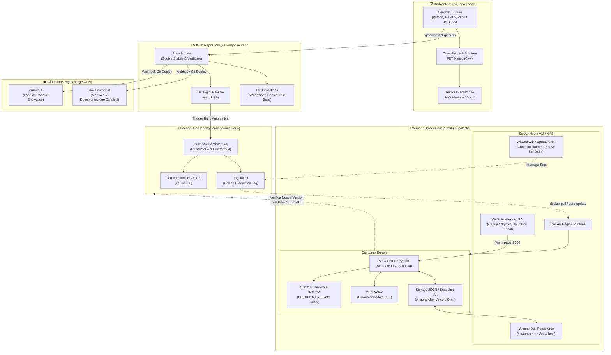
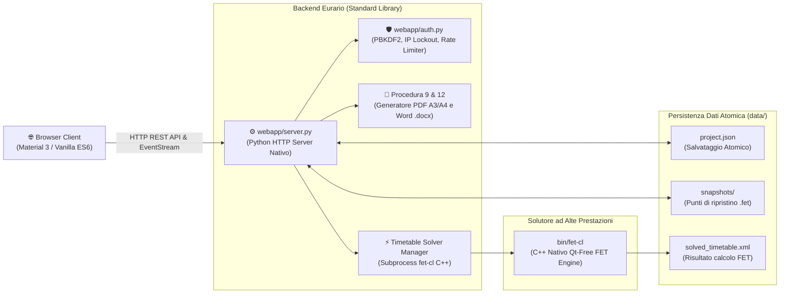
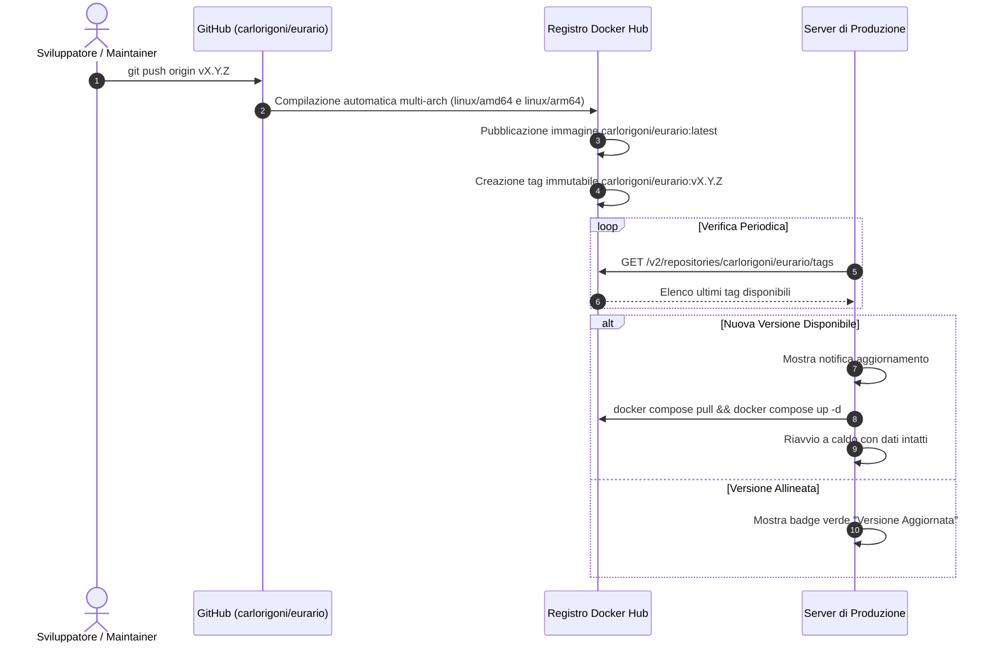
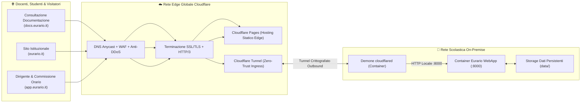

# 🏗️ Architettura del Software & Pipeline DevOps

Questo documento descrive l'architettura tecnica di Eurario e il flusso operativo di rilascio, distribuzione e aggiornamento.

---

## 1. Mappa E2E dell'Ecosistema Eurario

Il diagramma seguente illustra l'interazione tra ambiente di sviluppo, repository GitHub, registro Docker Hub, rete CDN Cloudflare e server di produzione:



---

## 2. Componenti Software Interni & Runtime Locale

L'architettura interna elimina librerie terze non necessarie per garantire stabilità a lungo termine.



### Dettaglio dei Singoli Componenti

#### 1. Frontend (Vanilla Web Stack)
* Sviluppato in HTML5 semantico, Vanilla JavaScript ES6+ e CSS moderno con variabili custom.
* Supporta il tema chiaro e il tema scuro in modo nativo.
* Interfaccia grafica conforme alle linee guida Material Design 3.
* Nessun bundler in fase di esecuzione. Il caricamento nel browser è immediato.
* Controllo della cache con query string di versione (`?v=X.Y.Z`).

#### 2. Backend Python (`webapp/server.py` & `webapp/auth.py`)
* Esegue su Python 3.10+ senza framework esterni.
* Utilizza esclusivamente la Standard Library di Python (`http.server`, `urllib`, `json`, `hashlib`, `subprocess`).
* Sicurezza accessi: hash password con PBKDF2-HMAC-SHA256 a 600.000 iterazioni e salting a 16 byte.
* Protezione brute-force: ritardo progressivo e blocco temporizzato per indirizzo IP.

#### 3. Motore Solutore Euristico (`bin/fet-cl`)
* Binario nativo C++ compilato dal sorgente ufficiale FET di Liviu Lalescu e Volker Dirr.
* Viene eseguito come subprocess asincrono headless senza interfaccia Qt.
* Comunica lo stato di avanzamento al server tramite standard output (stdout).

#### 4. Persistenza Atomica (`data/`)
* I dati scolastici risiedono in file JSON strutturati (`project.json`).
* Le scritture su disco sono atomiche: salvataggio su file temporaneo seguito da `os.replace`.
* Previene la corruzione dei dati in caso di spegnimento improvviso del server.

---

## 3. Gestione Versioni & Flusso Git

Eurario segue la specifica **Semantic Versioning (SemVer 2.0.0)** nel formato `vMAJOR.MINOR.PATCH`:
* **`MAJOR`**: Modifiche architetturali rilevanti o cambi di struttura dati non retrocompatibili.
* **`MINOR`**: Nuove funzionalità didattiche, nuove stampe o estensione dei vincoli FET.
* **`PATCH`**: Correzioni di bug, miglioramenti prestazionali e aggiornamenti di sicurezza.

### File Sincronizzati al Rilascio di Versione

| File | Variabile / Riferimento | Scopo |
| :--- | :--- | :--- |
| `webapp/server.py` | `APP_VERSION = "1.9.6"` | Risposta API e log di avvio server |
| `webapp/static/app.js` | `const APP_VERSION = '1.9.6'` | Verifica aggiornamenti su Docker Hub |
| `webapp/static/index.html` | Etichette interfaccia e cache buster | Sidebar, About modal e invalidazione asset browser |
| `landing/content/site_data.json` | `"current_version": "v1.9.6"` | Versione mostrata sul sito eurario.it |
| `landing/index.html` | Tag immagine Docker consigliata | Visualizzazione comando di download nella hero section |
| `zensical.toml` | Parametri asset CSS/JS | Cache busting della documentazione docs.eurario.it |

---

## 4. Pipeline di Pubblicazione su Docker Hub

Alla creazione di un nuovo tag Git (es. `git tag v1.9.6 && git push origin v1.9.6`), la pipeline esegue i seguenti passaggi:



### Supporto Multi-Architettura
La build genera un unico manifest multi-piattaforma per:
* **`linux/amd64`**: server Intel/AMD x86_64 e macchine virtuali cloud.
* **`linux/arm64`**: Apple Silicon (M-series), server ARM e Raspberry Pi 5.

---

## 5. Procedure di Aggiornamento in Produzione

### Procedura Manuale da Terminale
1. Accedi via SSH al server della scuola.
2. Posizionati nella directory di Eurario:
   ```bash
   cd /opt/eurario
   ```
3. Scarica la nuova immagine container:
   ```bash
   docker compose pull
   ```
4. Riavvia i container:
   ```bash
   docker compose up -d
   ```
5. Tutti i dati memorizzati nel volume `./data` rimangono preservati.

### Procedura di Aggiornamento Automatico con Watchtower
Per abilitare l'aggiornamento automatico orario senza intervento manuale:
1. Inserisci il servizio Watchtower nel file `docker-compose.yml`:
   ```yaml
   watchtower:
     image: containrrr/watchtower
     container_name: eurario_watchtower
     restart: unless-stopped
     environment:
       - DOCKER_API_VERSION=1.41
       - WATCHTOWER_HTTP_API_UPDATE=true
       - WATCHTOWER_HTTP_API_TOKEN=eurario-update-token
     volumes:
       - /var/run/docker.sock:/var/run/docker.sock
     command: --interval 3600 --cleanup eurario
   ```
2. Salva e riavvia con `docker compose up -d`.

### Procedura di Aggiornamento In-App ("Aggiorna ora")
1. Apri la barra laterale di Eurario nel browser.
2. Se è disponibile un aggiornamento, il badge di versione diventa ambra.
3. Fai clic sul badge di versione per aprire il modale di aggiornamento.
4. Fai clic sul pulsante **🚀 Aggiorna ora**.
5. Il server attiva l'aggiornamento tramite Watchtower o socket Docker locale.
6. Al termine del riavvio, fai clic su **Ricarica Pagina**.

---

## 6. Ruolo di Cloudflare nell'Ecosistema

Cloudflare gestisce la distribuzione CDN, la sicurezza perimetrale e l'accesso remoto on-premise:



### Vantaggi dell'Infrastruttura Edge
* **Cloudflare Pages**: ospita `eurario.it` e `docs.eurario.it` con build automatica su push Git e distribuzione edge globale.
* **WAF e Protezione DDoS**: blocca attacchi volumetrici e applicativi ai livelli 3, 4 e 7.
* **Cloudflare Tunnel**: consente l'accesso sicuro a Eurario da remoto senza aprire porte nel firewall scolastico e senza richiedere IP pubblico statico.
