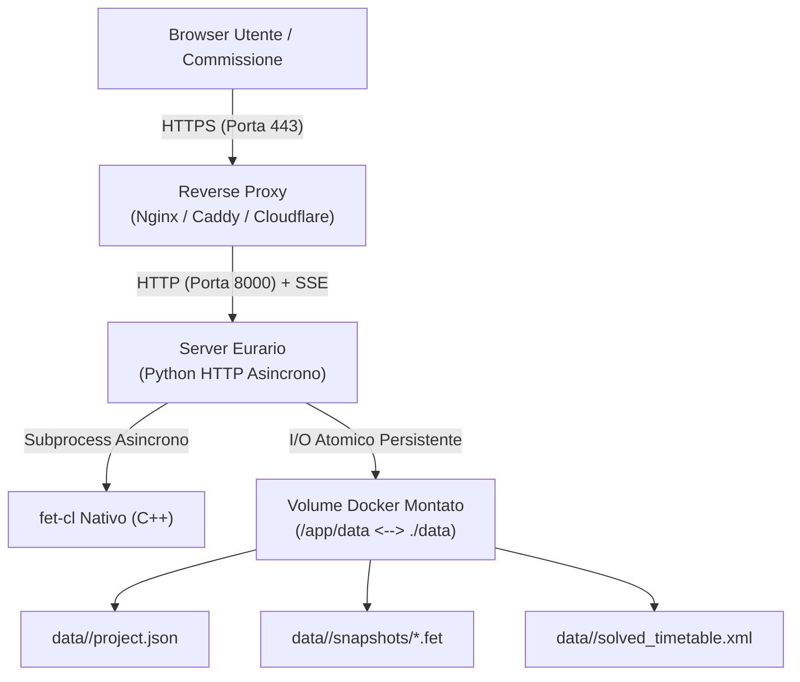

# 🐳 Installazione & Deploy con Docker

Questa guida descrive come installare ed eseguire Eurario su server dedicati, macchine virtuali o NAS scolastici tramite Docker.

> 📦 **Immagine Ufficiale su Docker Hub**: [`carlorigoni/eurario:latest`](https://hub.docker.com/r/carlorigoni/eurario)

---

## 1. Requisiti di Sistema

### Architetture Supportate
* **Linux x86_64 / amd64**: Server Intel o AMD, VPS Hetzner/OVH, hypervisor Proxmox VE o VMware ESXi.
* **Linux aarch64 / arm64**: Server Hetzner ARM, Apple Silicon (M1/M2/M3/M4), Raspberry Pi 5 con 4 GB+ RAM.

### Requisiti Hardware e Software
* **Sistema Operativo**: Ubuntu Server 22.04/24.04 LTS, Debian 12, Rocky Linux 9, Synology DSM 7+, macOS o Windows.
* **CPU e RAM**: Minimo 1 vCPU e 1 GB di RAM (consigliati 2 GB per scuole con più di 100 docenti).
* **Software**: Docker Engine 24+ e Docker Compose v2+.



---

## 2. Deploy Rapido con Docker Compose

### Scopo
Avviare Eurario in pochi secondi con persistenza dei dati e riavvio automatico.

### Procedura di Installazione
1. Crea una cartella per Eurario sul server ed entra al suo interno:
   ```bash
   mkdir -p /opt/eurario && cd /opt/eurario
   ```
2. Crea il file `docker-compose.yml`:
   ```bash
   nano docker-compose.yml
   ```
3. Incolla la seguente configurazione:
   ```yaml
   version: '3.8'

   services:
     eurario:
       image: carlorigoni/eurario:latest
       container_name: eurario-app
       restart: unless-stopped
       ports:
         - "8000:8000"
       volumes:
         - ./data:/app/data
       environment:
         - PORT=8000
         - PYTHONUNBUFFERED=1
         # Opzionale: ID Client Google Workspace OAuth 2.0
         # - GOOGLE_CLIENT_ID=vostro-client-id.apps.googleusercontent.com
         # Opzionale: Email superadmin approvato al primo avvio
         # - INITIAL_ADMIN_EMAIL=dirigente@istituto.edu.it
       healthcheck:
         test: ["CMD-SHELL", "python3 -c \"import urllib.request; urllib.request.urlopen('http://localhost:8000/api/summary')\""]
         interval: 30s
         timeout: 10s
         retries: 3
         start_period: 10s
   ```
4. Salva il file e avvia il container in background:
   ```bash
   docker compose up -d
   ```
5. Verifica lo stato del container:
   ```bash
   docker compose ps
   ```
6. Apri il browser all'indirizzo `http://indirizzo-ip-server:8000`.

---

## 3. Variabili di Ambiente

| Variabile | Valore Predefinito | Descrizione |
| :--- | :---: | :--- |
| `PORT` | `8000` | Porta TCP di ascolto del server interno. |
| `PYTHONUNBUFFERED` | `1` | Disattiva il buffer interno per i log in tempo reale. |
| `GOOGLE_CLIENT_ID` | *(non impostato)* | ID Client Google Workspace OAuth 2.0 per il login. Se omesso, abilita la modalità locale standalone. |
| `INITIAL_ADMIN_EMAIL` | *(non impostato)* | Indirizzo email d'istituto promosso a superadmin al primo accesso. |

---

## 4. Persistenza dei Dati & Backup

### Scopo
Proteggere le anagrafiche della scuola e consentire il ripristino immediato in caso di guasto.

### Struttura della Cartella Dati
```text
/opt/eurario/data/
├── default/                         # Scuola predefinita
│   ├── project.json                 # Anagrafiche, cattedre, vincoli
│   ├── solved_timetable.xml         # Ultimo orario calcolato
│   └── snapshots/                   # Istantanee orario salvate
│       ├── 20261027_baseline.fet
│       └── 20261027_definitivo.fet
└── liceo_musicale/                  # Altro istituto (Multi-Tenant)
    └── project.json
```

### Procedura di Backup Automatico
1. Configura una voce crontab sul server:
   ```bash
   crontab -e
   ```
2. Inserisci il comando per eseguire il backup notturno alle 02:00:
   ```bash
   0 2 * * * tar -czvf /backup/eurario-$(date +\%F).tar.gz -C /opt/eurario data/
   ```

### Procedura di Ripristino Backup
1. Ferma il container di Eurario:
   ```bash
   docker compose down
   ```
2. Ripristina l'archivio compresso nella cartella del progetto:
   ```bash
   tar -xzvf /backup/eurario-2026-10-27.tar.gz -C /opt/eurario/
   ```
3. Riavvia il container:
   ```bash
   docker compose up -d
   ```

---

## 5. Reverse Proxy & Certificato SSL / HTTPS

### Scopo
Garantire comunicazioni cifrate e abilitare lo streaming Server-Sent Events (SSE) per il solutore.

### Opzione A: Configurazione con Nginx
1. Installa Nginx sul server host.
2. Crea il file `/etc/nginx/sites-available/eurario`:
   ```nginx
   server {
       listen 80;
       server_name orario.scuola.edu.it;
       return 301 https://$host$request_uri;
   }

   server {
       listen 443 ssl http2;
       server_name orario.scuola.edu.it;

       ssl_certificate /etc/letsencrypt/live/orario.scuola.edu.it/fullchain.pem;
       ssl_certificate_key /etc/letsencrypt/live/orario.scuola.edu.it/privkey.pem;
       ssl_protocols TLSv1.2 TLSv1.3;

       location / {
           proxy_pass http://127.0.0.1:8000;
           proxy_set_header Host $host;
           proxy_set_header X-Real-IP $remote_addr;
           proxy_set_header X-Forwarded-For $proxy_add_x_forwarded_for;
           proxy_set_header X-Forwarded-Proto $scheme;

           # Disattiva il buffer per lo streaming SSE del solutore
           proxy_http_version 1.1;
           proxy_set_header Connection '';
           proxy_buffering off;
           proxy_cache off;
           chunked_transfer_encoding off;
           proxy_read_timeout 600s;
       }
   }
   ```
3. Abilita il sito e ricarica Nginx:
   ```bash
   sudo ln -s /etc/nginx/sites-available/eurario /etc/nginx/sites-enabled/
   sudo nginx -t && sudo systemctl reload nginx
   ```

### Opzione B: Configurazione con Caddy
Inserisci nel file `Caddyfile`:
```caddyfile
orario.scuola.edu.it {
    reverse_proxy localhost:8000 {
        header_up Host {host}
        header_up X-Real-IP {remote_host}
    }
}
```

### Opzione C: Cloudflare Tunnel (Senza Porte Aperte nel Firewall)
Utile per istituti con connessione a IP dinamico o firewall ministeriale:
1. Installa il pacchetto `cloudflared`:
   ```bash
   curl -L --output cloudflared.deb https://github.com/cloudflare/cloudflared/releases/latest/download/cloudflared-linux-amd64.deb
   sudo dpkg -i cloudflared.deb
   ```
2. Esegui il login e crea il tunnel:
   ```bash
   cloudflared tunnel login
   cloudflared tunnel create eurario-scuola
   cloudflared tunnel route dns eurario-scuola orario.scuola.edu.it
   ```
3. Avvia il tunnel puntando alla porta locale 8000:
   ```bash
   cloudflared tunnel run --url http://localhost:8000 eurario-scuola
   ```
