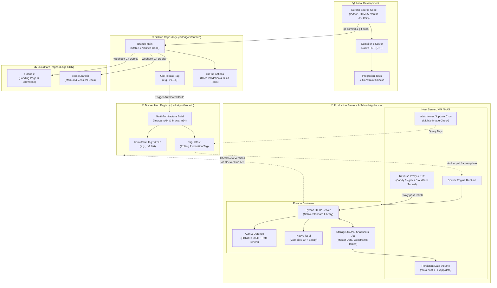
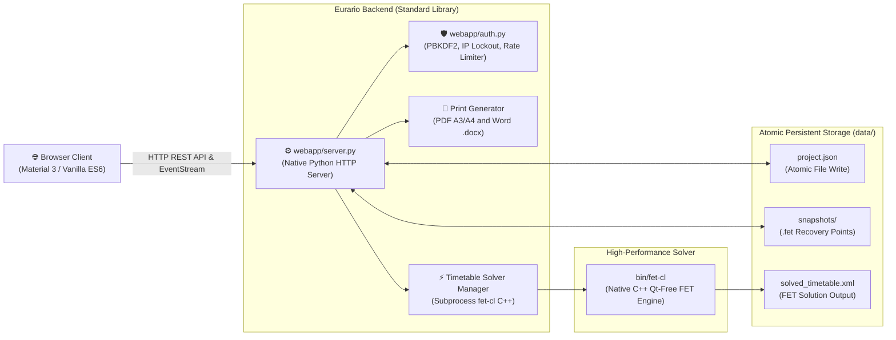
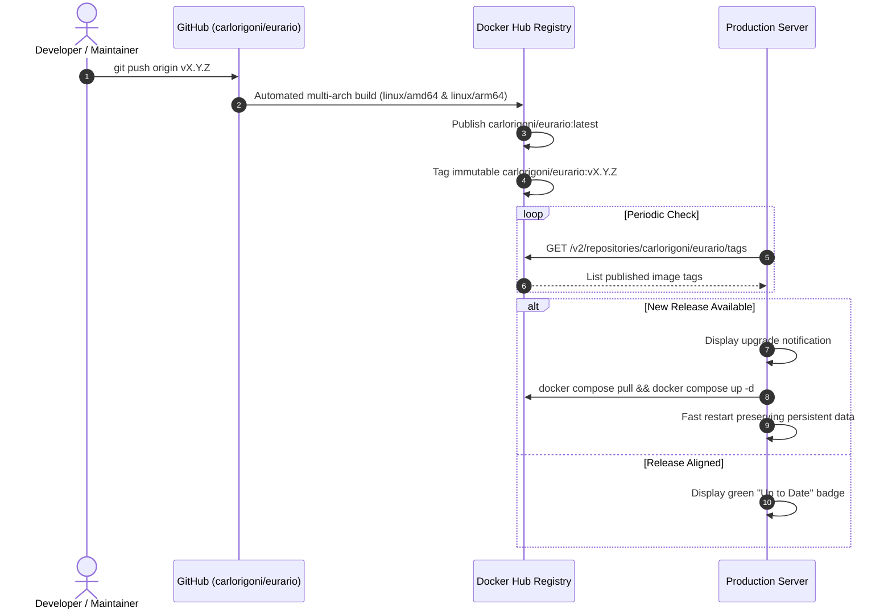
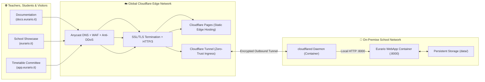

# 🏗️ Software Architecture & DevOps Pipeline

This technical document describes the software architecture of Eurario and its operational release, deployment, and upgrade workflows.

---

## 1. End-to-End Ecosystem Map

The following diagram illustrates interactions across the local development environment, GitHub repository, Docker Hub registry, Cloudflare CDN, and production school servers:



---

## 2. Internal Software Components & Local Runtime

The internal architecture eliminates external framework bloat to ensure long-term maintenance and stability.



### Component Breakdown

#### 1. Frontend (Zero-Framework Vanilla Stack)
* Built using semantic HTML5, Vanilla JavaScript ES6+, and modern CSS with custom properties.
* Features native Light and Dark theme support.
* UI components follow Material Design 3 guidelines.
* No bundler runtime requirement. The browser executes code immediately.
* Cache control handled via asset version query parameters (`?v=X.Y.Z`).

#### 2. Python Backend (`webapp/server.py` & `webapp/auth.py`)
* Runs on Python 3.10+ without external web frameworks.
* Built exclusively with the Python Standard Library (`http.server`, `urllib`, `json`, `hashlib`, `subprocess`).
* Security controls: PBKDF2-HMAC-SHA256 password hashing with 600,000 iterations and 16-byte cryptographic salt.
* Brute-force defense: exponential delay tarpitting and automatic IP lockout.

#### 3. Native Solver Engine (`bin/fet-cl`)
* Native C++ binary compiled from official FET sources created by Liviu Lalescu and Volker Dirr.
* Runs as an asynchronous headless subprocess without the Qt GUI.
* Reports real-time calculation progress to the server via standard output (stdout).

#### 4. Atomic File Storage (`data/`)
* School master data stored in structured JSON format (`project.json`).
* Disk operations are atomic: files write to temporary paths before atomic `os.replace`.
* Protects against data corruption during unexpected server power outages.

---

## 3. Version Management & Git Flow

Eurario adheres strictly to **Semantic Versioning (SemVer 2.0.0)** in `vMAJOR.MINOR.PATCH` format:
* **`MAJOR`**: Substantial architectural changes or breaking data model updates.
* **`MINOR`**: New educational features, print layout additions, or solver constraint extensions.
* **`PATCH`**: Bug fixes, performance optimizations, and security patches.

### Synchronized Version Identifiers

| File | Variable / Reference | Purpose |
| :--- | :--- | :--- |
| `webapp/server.py` | `APP_VERSION = "1.9.6"` | API endpoint responses and server startup logs |
| `webapp/static/app.js` | `const APP_VERSION = '1.9.6'` | Docker Hub remote upgrade checks |
| `webapp/static/index.html` | Interface tags and asset cache busters | Sidebar, About modal, and browser cache invalidation |
| `landing/content/site_data.json` | `"current_version": "v1.9.6"` | Version badge shown on eurario.it |
| `landing/index.html` | Recommended Docker image tag | Pull command rendered on the homepage hero section |
| `zensical.toml` | Asset cache query strings | Cache busting for docs.eurario.it |

---

## 4. Docker Hub Automated Container Pipeline

Pushing a new Git tag (e.g., `git tag v1.9.6 && git push origin v1.9.6`) triggers the container build workflow:



### Multi-Architecture Images
The build process generates a single multi-platform manifest for:
* **`linux/amd64`**: Intel/AMD x86_64 servers and cloud virtual machines.
* **`linux/arm64`**: Apple Silicon (M-series), ARM servers, and Raspberry Pi 5.

---

## 5. Production Upgrade Procedures

### Manual Terminal Upgrade Procedure
1. Connect to the host server via SSH.
2. Navigate into the Eurario project directory:
   ```bash
   cd /opt/eurario
   ```
3. Pull the updated container image:
   ```bash
   docker compose pull
   ```
4. Recreate and restart containers:
   ```bash
   docker compose up -d
   ```
5. All school records in `./data` remain intact.

### Automated Hourly Upgrades with Watchtower
To enable fully automated, hands-off container updates:
1. Add the Watchtower service to your `docker-compose.yml`:
   ```yaml
   watchtower:
     image: containrrr/watchtower
     container_name: eurario_watchtower
     restart: unless-stopped
     environment:
       - DOCKER_API_VERSION=1.41
       - WATCHTOWER_HTTP_API_UPDATE=true
       - WATCHTOWER_HTTP_API_TOKEN=eurario-update-token
     volumes:
       - /var/run/docker.sock:/var/run/docker.sock
     command: --interval 3600 --cleanup eurario
   ```
2. Apply changes with `docker compose up -d`.

### In-App One-Click Upgrade ("Upgrade Now")
1. Open the Eurario sidebar in your browser.
2. When an update is available, the version badge turns amber.
3. Click the badge to open the upgrade dialog.
4. Click **🚀 Upgrade Now**.
5. The backend triggers the update using Watchtower or the local Docker socket.
6. When the restart completes, click **Reload Page**.

---

## 6. Cloudflare Role in the Ecosystem

Cloudflare delivers global CDN acceleration, perimeter protection, and zero-trust on-premise ingress:



### Architecture Highlights
* **Cloudflare Pages**: hosts `eurario.it` and `docs.eurario.it` with instant edge builds on Git push.
* **WAF & DDoS Shield**: mitigates layer 3, 4, and 7 threats at the edge.
* **Cloudflare Tunnel**: enables remote HTTPS access to Eurario without opening inbound router ports and without static public IPs.
