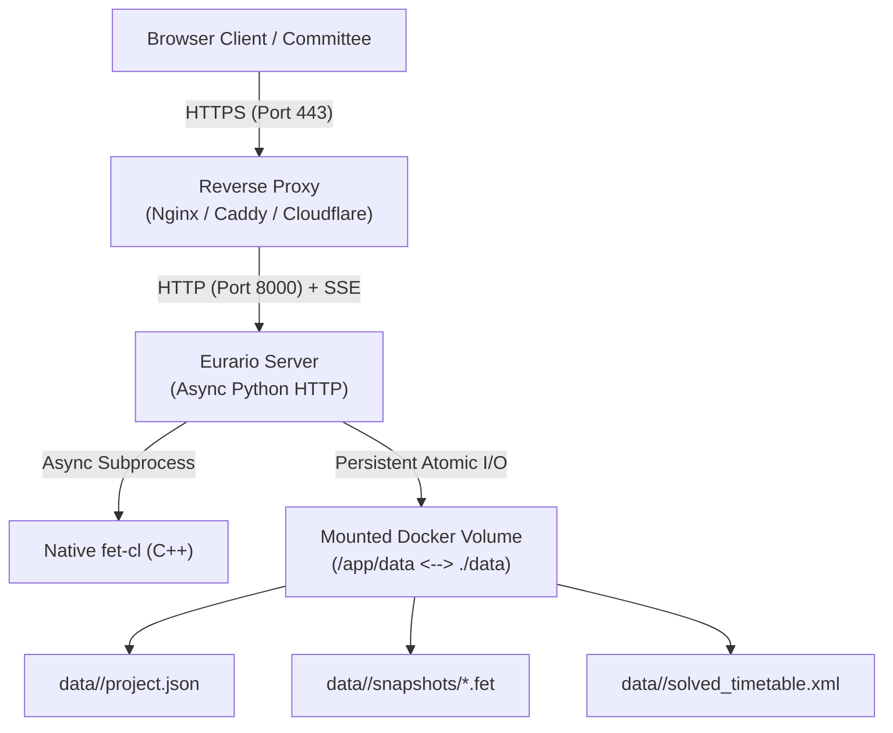

# 🐳 Docker Installation & Deployment

This guide describes how to install and run Eurario on dedicated servers, virtual machines, or school NAS appliances using Docker.

> 📦 **Official Docker Hub Image**: [`carlorigoni/eurario:latest`](https://hub.docker.com/r/carlorigoni/eurario)

---

## 1. System Requirements

### Supported Architectures
* **Linux x86_64 / amd64**: Intel or AMD servers, Hetzner/OVH VPS, Proxmox VE, or VMware ESXi hypervisors.
* **Linux aarch64 / arm64**: Hetzner ARM servers, Apple Silicon (M1/M2/M3/M4), Raspberry Pi 5 with 4 GB+ RAM.

### Hardware and Software Requirements
* **Operating System**: Ubuntu Server 22.04/24.04 LTS, Debian 12, Rocky Linux 9, Synology DSM 7+, macOS, or Windows.
* **CPU and RAM**: Minimum 1 vCPU and 1 GB RAM (2 GB recommended for schools with over 100 teachers).
* **Software**: Docker Engine 24+ and Docker Compose v2+.



---

## 2. Quick Deploy with Docker Compose

### Purpose
Launch Eurario in seconds with persistent data storage and automatic container restarts.

### Deployment Procedure
1. Create a project folder on your server and navigate into it:
   ```bash
   mkdir -p /opt/eurario && cd /opt/eurario
   ```
2. Create the `docker-compose.yml` file:
   ```bash
   nano docker-compose.yml
   ```
3. Paste the following configuration:
   ```yaml
   version: '3.8'

   services:
     eurario:
       image: carlorigoni/eurario:latest
       container_name: eurario-app
       restart: unless-stopped
       ports:
         - "8000:8000"
       volumes:
         - ./data:/app/data
       environment:
         - PORT=8000
         - PYTHONUNBUFFERED=1
         # Optional: Google Workspace OAuth 2.0 Client ID
         # - GOOGLE_CLIENT_ID=your-client-id.apps.googleusercontent.com
         # Optional: Superadmin email promoted on first login
         # - INITIAL_ADMIN_EMAIL=principal@school.edu
       healthcheck:
         test: ["CMD-SHELL", "python3 -c \"import urllib.request; urllib.request.urlopen('http://localhost:8000/api/summary')\""]
         interval: 30s
         timeout: 10s
         retries: 3
         start_period: 10s
   ```
4. Save the file and start the container in detached mode:
   ```bash
   docker compose up -d
   ```
5. Verify container status:
   ```bash
   docker compose ps
   ```
6. Open your web browser and navigate to `http://server-ip-address:8000`.

---

## 3. Environment Variables

| Variable | Default Value | Description |
| :--- | :---: | :--- |
| `PORT` | `8000` | Internal HTTP listening port. |
| `PYTHONUNBUFFERED` | `1` | Disables internal log buffering for real-time output. |
| `GOOGLE_CLIENT_ID` | *(unset)* | Google Workspace OAuth 2.0 Client ID. If omitted, standalone local mode is enabled. |
| `INITIAL_ADMIN_EMAIL` | *(unset)* | Institutional email automatically promoted to Superadmin on first login. |

---

## 4. Data Persistence & Backup

### Purpose
Safeguard school master records and enable quick recovery in case of hardware failure.

### Data Directory Layout
```text
/opt/eurario/data/
├── default/                         # Default school
│   ├── project.json                 # Master data, teaching loads, constraints
│   ├── solved_timetable.xml         # Latest solved timetable
│   └── snapshots/                   # Historical timetable checkpoints
│       ├── 20261027_baseline.fet
│       └── 20261027_final.fet
└── music_academy/                   # Additional school (Multi-Tenant)
    └── project.json
```

### Automated Backup Procedure
1. Edit your server crontab:
   ```bash
   crontab -e
   ```
2. Add the scheduled backup job for 02:00 every night:
   ```bash
   0 2 * * * tar -czvf /backup/eurario-$(date +\%F).tar.gz -C /opt/eurario data/
   ```

### Restore Procedure
1. Stop the Eurario container:
   ```bash
   docker compose down
   ```
2. Extract the archive into your project directory:
   ```bash
   tar -xzvf /backup/eurario-2026-10-27.tar.gz -C /opt/eurario/
   ```
3. Restart the container:
   ```bash
   docker compose up -d
   ```

---

## 5. Reverse Proxy & SSL / HTTPS Setup

### Purpose
Provide encrypted traffic and support Server-Sent Events (SSE) streaming for the FET solver.

### Option A: Setup with Nginx
1. Install Nginx on the host server.
2. Create `/etc/nginx/sites-available/eurario`:
   ```nginx
   server {
       listen 80;
       server_name timetable.school.edu;
       return 301 https://$host$request_uri;
   }

   server {
       listen 443 ssl http2;
       server_name timetable.school.edu;

       ssl_certificate /etc/letsencrypt/live/timetable.school.edu/fullchain.pem;
       ssl_certificate_key /etc/letsencrypt/live/timetable.school.edu/privkey.pem;
       ssl_protocols TLSv1.2 TLSv1.3;

       location / {
           proxy_pass http://127.0.0.1:8000;
           proxy_set_header Host $host;
           proxy_set_header X-Real-IP $remote_addr;
           proxy_set_header X-Forwarded-For $proxy_add_x_forwarded_for;
           proxy_set_header X-Forwarded-Proto $scheme;

           # Disable buffering for real-time SSE streaming
           proxy_http_version 1.1;
           proxy_set_header Connection '';
           proxy_buffering off;
           proxy_cache off;
           chunked_transfer_encoding off;
           proxy_read_timeout 600s;
       }
   }
   ```
3. Enable the site and reload Nginx:
   ```bash
   sudo ln -s /etc/nginx/sites-available/eurario /etc/nginx/sites-enabled/
   sudo nginx -t && sudo systemctl reload nginx
   ```

### Option B: Setup with Caddy
Add this block to your `Caddyfile`:
```caddyfile
timetable.school.edu {
    reverse_proxy localhost:8000 {
        header_up Host {host}
        header_up X-Real-IP {remote_host}
    }
}
```

### Option C: Cloudflare Tunnel (Zero Open Ports)
Ideal for schools with dynamic IP addresses or restrictive upstream firewalls:
1. Install the `cloudflared` package:
   ```bash
   curl -L --output cloudflared.deb https://github.com/cloudflare/cloudflared/releases/latest/download/cloudflared-linux-amd64.deb
   sudo dpkg -i cloudflared.deb
   ```
2. Log in and create the tunnel:
   ```bash
   cloudflared tunnel login
   cloudflared tunnel create eurario-school
   cloudflared tunnel route dns eurario-school timetable.school.edu
   ```
3. Run the tunnel targeting port 8000:
   ```bash
   cloudflared tunnel run --url http://localhost:8000 eurario-school
   ```
