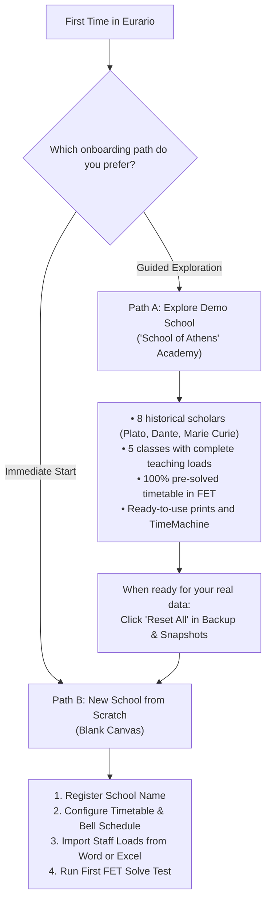
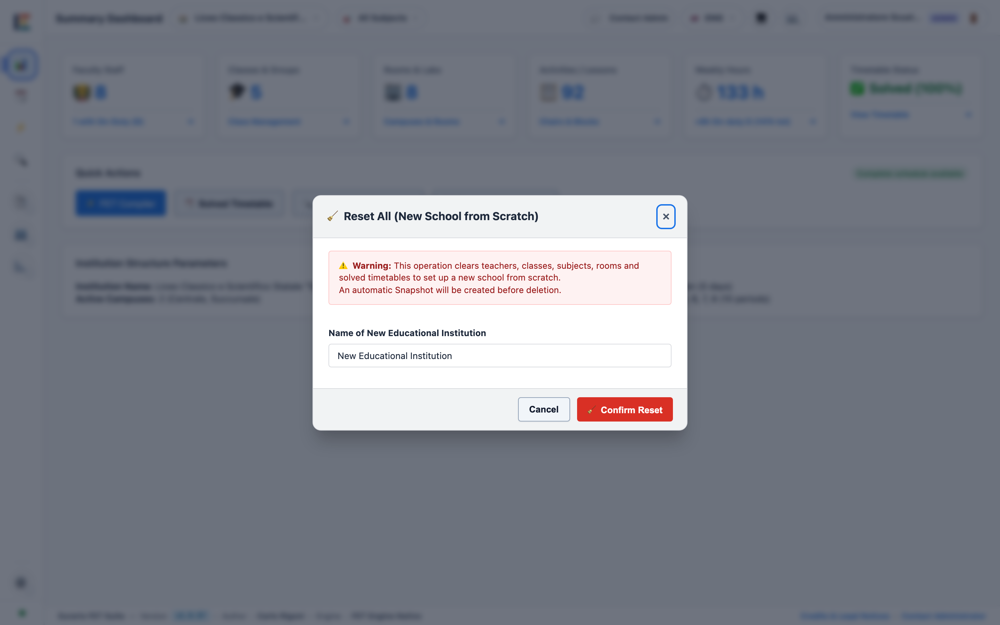
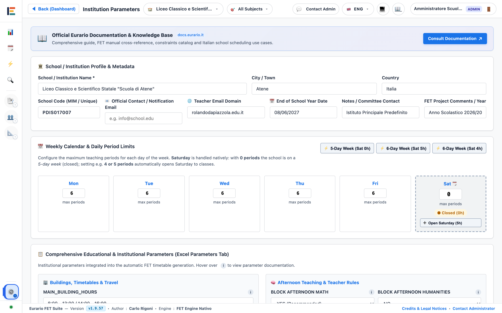

# 🚀 Getting Started & Initial Setup

This operational guide walks the school timetabling committee through their initial steps in Eurario.

Follow the numbered procedures to register a new school, configure essential timetable parameters, and import faculty staff assignments from files without manual typing.

---

## 1. Overcoming Blank Canvas Paralysis: Choosing an Initial Strategy

### Purpose
Familiarize yourself with the interface before entering real data, or start immediately with a clean school setup.

Eurario provides two onboarding pathways:

### Path A: Explore the Demo School ("School of Athens")
1. On initial access, Eurario automatically loads the **School of Athens** demo institution.
2. Open the **Teachers** tab to examine how contract days off and target hours are set up.
3. Open the **Timetable Board** tab to see a 100% solved schedule produced by the FET engine.
4. Click the **TimeMachine** button to inspect hourly occupancy flows and inter-campus commutes.
5. You can restore this demo dataset at any time by navigating to **Backup & Snapshots** &rarr; **Restore Sample Data ("School of Athens")**.

  
  
Figure 1.1: Modal dialog to instantly restore the "School of Athens" demo school with a pre-solved schedule.

### Path B: Reset to a Clean Blank Canvas for a New School
When you are ready to configure your own institution:
1. Open the **Backup & Snapshots** tab from the main sidebar.
2. Locate the **Sample Timetables & Project Reset** section.
3. Click the red button **🧹 Reset All (Blank Sheet)**.
4. Enter your school's official name into the dialog field.
5. Click **Confirm Reset**.
6. Eurario takes an automatic safety snapshot and clears teachers, classes, and subjects, providing a clean workspace.

  
  
Figure 1.2: Reset modal to initialize a clean slate workspace from scratch.

---

## 2. Registering a New Educational Institution (Multi-School)

### Purpose
Create an isolated data space for a new school or academic year without overwriting existing projects.

  
  
Figure 1.3: School registration modal with official school name, national code, and committee contact details.

### Registration Procedure
1. Click the **Schools** dropdown selector in the top navigation bar.
2. Click **➕ Register New School...**.
3. Enter the **School Name** (e.g., *Galileo Galilei High School*).
4. Enter the municipality in the **City / Municipality** field.
5. Enter the school's official **Institutional Code** (e.g., `RMPS010004`).
6. Enter the **Official Contact Email** for the timetabling committee.
7. Enter administrative notes in the **Notes / Committee Contact** field.
8. Click **🚀 Register and Enter**.
9. The application immediately switches your active session to the new empty school.

---

## 3. Core School Parameters & Bell Schedule

### Purpose
Define the weekly day structure, daily period count, bell schedule, and contract rules before entering lessons.

> [!IMPORTANT]
> Configure school parameters before setting up teaching loads. The FET compiler builds its mathematical constraint matrix (days × periods) directly from these settings.

  
  
Figure 1.4: Parameter configuration view for weekly calendar, daily periods, bell timetable, and break intervals.

### Essential Parameters to Configure

| Section | Parameter | Typical Value | Technical Description |
| :--- | :--- | :---: | :--- |
| **Weekly Schedule** | Days per week | `5` or `6` days | 5 days for short week (Mon-Fri); 6 days including Saturday. |
| **Daily Periods** | Max periods per day | `6` periods | Maximum daily periods in the morning for students and teachers. |
| **Afternoon Sessions** | Extra periods | `0`, `1`, or `2` | Enables 7th and 8th periods for technical, vocational, or arts tracks. |
| **Bell Schedule** | Period 1 start time | `08:00` | Start time for the first morning period. |
| **Period Duration** | Minutes per period | `60` min | Duration of each lesson unit (e.g., 60 min or 55 min). |
| **Recess Interval** | Placement & duration | After period 3 (15m) | Pauses lessons for the institutional recess break. |
| **Teacher Daily Load** | Max hours per day | `4` or `5` hours | Caps consecutive daily teaching workload per teacher. |
| **Teacher Daily Load** | Min hours per day | `2` hours | Prevents scheduling single isolated 1-hour teaching days. |
| **Teacher Idle Gaps** | Max gaps per day | `1` gap | Restricts unpaid waiting windows between lessons. |
| **Teacher Idle Gaps** | Max gaps per week | `2` or `3` gaps | Total weekly upper bound on idle periods for the FET solver. |

### Configuration Procedure
1. Open the **Institute Parameters** tab from the main navigation.
2. Select your weekly structure: enable or disable **Saturday**.
3. Set the start time and period duration for the bell schedule.
4. Configure the position and duration of the recess break.
5. Set upper limits for daily and weekly teacher idle gaps.
6. Click **Save Parameters**.

---

## 4. Rapid Teaching Staff Import from Files

### Purpose
Load your full teacher roster, subject assignments, and student classes directly from office files without manual keyboard entry.

### Method 1: Import via Official Word Template (`.docx`)
Eurario includes a standardized 4-column Word template matching standard school administration records:

  
  
Figure 1.5: Faculty staff synchronization modal from Word (.docx) or Google Docs with template download.

#### Word Import Procedure
1. Open the **Teaching Loads (Cattedre)** tab from the main navigation.
2. Click **Update from Word (.docx)**.
3. If you do not have a formatted file, click **📥 Download Sample Model (.docx)**.
4. Fill in the Word table with the required 4 columns:
   * **Competition Code**: e.g. `A027`, `A012`, `A048`.
   * **Teacher**: Teacher full name (e.g., `Rossi Mario`).
   * **Classes**: Assigned classes list (e.g., `1A, 2A, 3B`).
   * **Hours**: Weekly periods per class (e.g., `4, 4, 3`).
5. Drop your completed file into the upload zone or click **Select Word File**.
6. Review the side-by-side **Diff Viewer**:
   * Green badges indicate new teachers and loads to add.
   * Yellow badges indicate hour modifications.
   * Red badges indicate items no longer present in the file.
7. Select your preferred checkboxes and click **Apply Selected Changes**.
8. Eurario automatically takes a safety snapshot and populates the database.

### Method 2: Align Teaching Loads & Contracts via Excel (`.xlsx` or CSV)
To import comprehensive contractual records including split contracts (COE), part-time, and target working days:

  
  
Figure 1.6: Contract alignment modal from Excel (.xlsx), CSV, or pasted tabular text.

#### Expected Excel Column Structure:
| Column 1 | Column 2 | Column 3 | Column 4 | Column 5 | Column 6 |
| :---: | :---: | :---: | :---: | :---: | :---: |
| **Subject Code** | **Teacher** | **Assigned Classes** | **Weekly Hours** | **Contract Type** | **Working Days** |
| `A027` | Descartes | 1A (4h), 2A (4h), 3A (4h) | 18 | `Full-Time` | `5` |
| `A012` | Homer | 4B (6h), 5B (6h) | 12 | `Part-Time` | `3` |
| `A048` | Archimedes | 1A (2h), 2A (2h) | 10 (+8h ext.) | `COE` | `3` |

#### Excel Import Procedure
1. In the **Teaching Loads** tab, click **Align Teaching Loads (Excel / CSV)**.
2. Select the **📁 Upload Excel (.xlsx) or CSV** tab or paste rows directly into the **📋 Paste Text** tab.
3. Select your spreadsheet file.
4. Click **Analyze File**.
5. Verify automated detection of contract types (Full-Time, Part-Time, COE).
6. Click **Apply Alignment**.

---

## 5. Physical Spaces (Main Campus & Home Classrooms)

### Purpose
Ensure every imported class has an assigned campus building and dedicated home room for ordinary lessons.

  
  
Figure 1.7: School campus buildings, base classrooms, and shared sports facilities.

### Space Setup Procedure
1. Open the **Spaces & Rooms** tab from the main navigation.
2. Confirm that at least one main campus exists (e.g., *Main Campus* with short code `M`).
3. Under **Rooms & Laboratories**, create a home room for each imported class (e.g., *Room 1A*, *Room 2B*).
4. Assign a maximum seating capacity matching your student headcount.
5. If your school has shared facilities (e.g., *Gymnasium*, *Computer Lab*), add them and check **Lab or Gym**.
6. Open the **Classes** tab and verify that each class is linked to its respective home room.

---

## 6. Coherence Verification & First Test with FET Solver

### Purpose
Verify that total weekly class hours match curriculum requirements and execute an initial solver run to confirm mathematical feasibility.

  
  
Figure 1.8: Teaching loads board displaying column hour sums per class and automatic block decomposition.

### Verification & Solve Test Procedure
1. Open the **Teaching Loads** tab and check total period sums at the bottom of each class column:
   * Junior high school cohorts typically require **27 hours**.
   * Senior high school cohorts typically require **30 hours**.
   * Technical academies typically require **32 or 33 hours**.
2. Verify that automatic block splits (`2+1+1`, `2+2+1`, etc.) match pedagogical requirements.
3. Open the **Timetable Solver** tab from the sidebar.
4. Set a time limit of **60 seconds**.
5. Click **Start Solver**.
6. When constraints are mathematically coherent, FET produces a valid schedule in seconds and opens the **Timetable Board**.
7. If the solver reports a conflict or reaches a timeout, open the **Diagnostics** tab to review recommendations from the *Relaxation Engine*.
