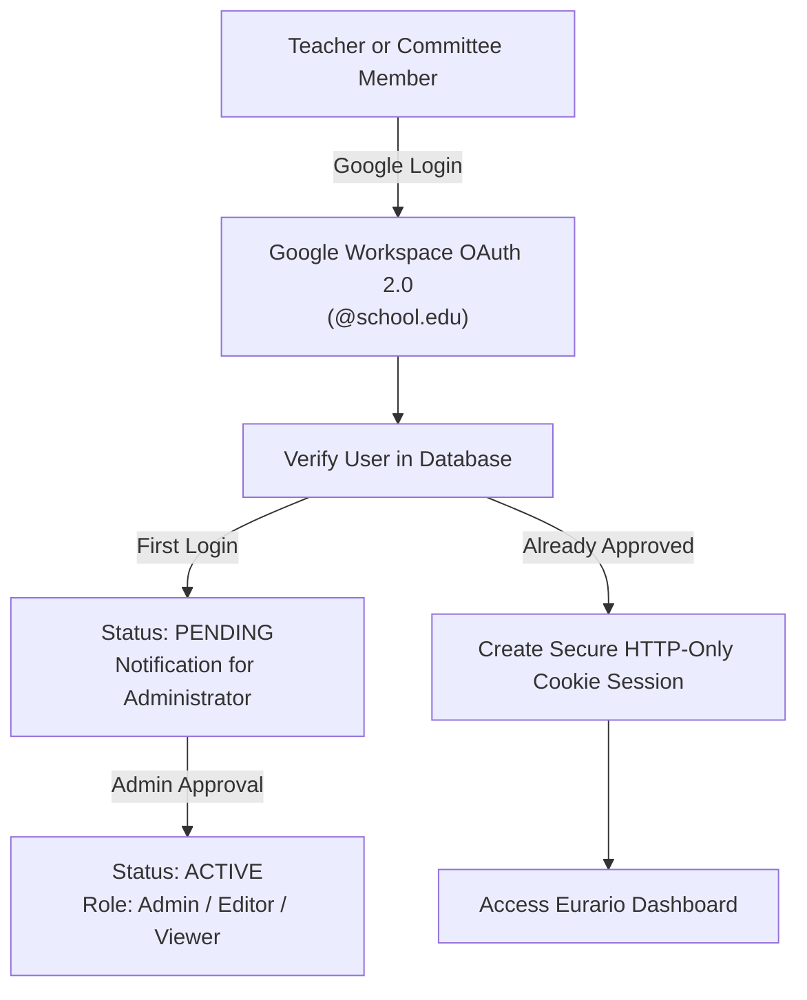
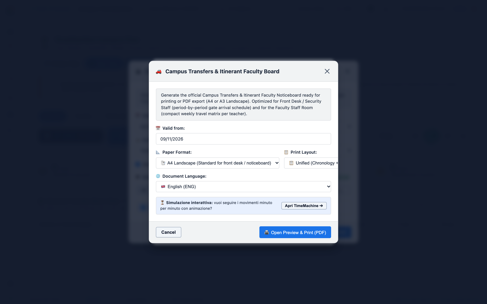
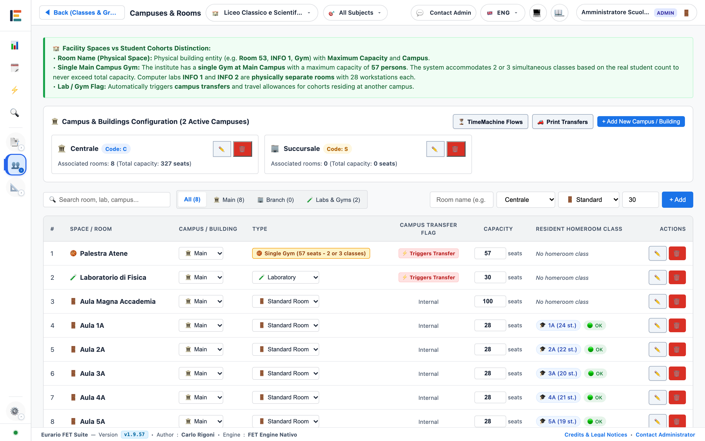
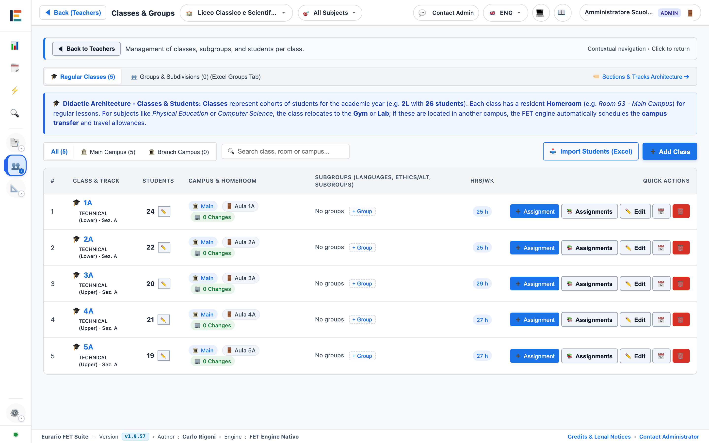
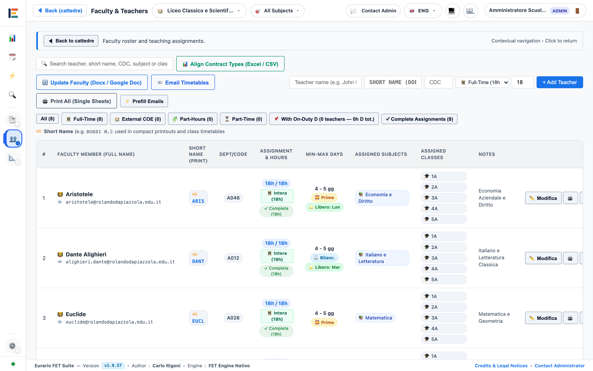
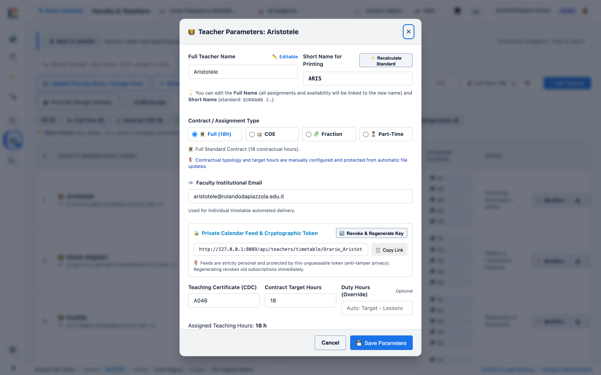
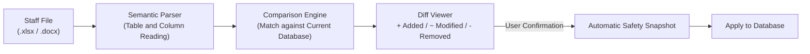

# 🚀 Getting Started & Initial Setup

This operational guide describes the initial configuration of Eurario. Follow the numbered procedures to configure authentication, physical facilities, student cohorts, subjects, and teachers.

---

## 1. Authentication & Access Control (RBAC)

### Purpose
Protect school institutional data and assign correct operational permissions to authorized personnel.

### First Login Procedure
1. Open the Eurario web address in your browser.
2. Click the **Sign in with Google** button.
3. Select your institutional account with the official school domain (e.g., `@school.edu`).
4. Wait for system administrator approval.
5. After approval, refresh the page to enter the dashboard.

  
  
Figure 1.1: Access management modal, user approval queue, and RBAC role assignment.

### Available User Roles
* **Admin**: Manages all schools, approves users, and configures global parameters.
* **Editor**: Modifies master data, teaching loads, constraints, and runs the timetable solver.
* **Viewer**: Views timetables and downloads official printouts without write permissions.

> [!NOTE]
> When `GOOGLE_CLIENT_ID` is omitted from server settings, Eurario starts in standalone local mode with immediate open access.

---

## 2. Multi-School Management (Multi-Tenant)

### Purpose
Manage multiple independent schools or distinct academic years inside a single server deployment.

### Key Multi-Tenant Features
* **Data Isolation**: Files for each school reside in an isolated folder under `data/<school_id>/`.
* **Fast Switching**: Select the school name from the top dropdown selector.
* **Optimistic Concurrency Control (OCC)**: Every save operation increments the `data_version` counter. When two users edit simultaneously, the system prevents data loss and displays differences.

### Procedure to Create a New School
1. Click the school selector in the top navigation bar.
2. Select **New School...**.
3. Enter the official name of the institution (e.g., *Galileo Galilei High School*).
4. Choose between an empty dataset or the pre-filled demo dataset *School of Athens*.
5. Click **Create School**.

---

## 3. School Buildings & Rooms Management

### Purpose
Define physical campuses and classrooms before assigning lesson activities to student classes.

  
  
Figure 1.2: Campus buildings, standard classrooms, computer labs, and capacity management.

### Procedure to Add a Campus Building
1. Open the **Spaces & Rooms** tab from the main navigation.
2. Locate the **School Buildings** section.
3. Click **+ New Building**.
4. Enter the **Building Name** (e.g., *Main Campus*).
5. Enter the **Short Code** (e.g., `M`).
6. Enter the **Travel Time** in minutes to other buildings.
7. Click **Save Building**.

### Procedure to Add a Room or Laboratory
1. In the **Spaces & Rooms** tab, locate the **Rooms & Labs** section.
2. Click **+ New Room**.
3. Enter the **Room Name** (e.g., *Computer Lab 1* or *Main Gymnasium*).
4. Select the **Associated Building**.
5. Enter the maximum **Student Capacity**.
6. Select the **Room Type** (*Standard*, *Lab*, *Gymnasium*).
7. If multiple classes share this facility, enable the **Lab or Gym** checkbox.
8. Click **Save Room**.

> [!WARNING]
> Travel time between buildings must reflect real commuting duration. The FET solver uses this value to prevent back-to-back lessons in different buildings without travel time.

---

## 4. Student Classes & Track Split Groups

### Purpose
Define student classes, assign home rooms, and configure split track groupings.

  
  
Figure 1.3: Class roster, assigned base room, and weekly hour preset.

### Procedure to Add a Standard Class
1. Open the **Classes** tab from the main navigation.
2. Click **+ New Class**.
3. Enter the **Class Name** (e.g., `1A`, `3CSA`).
4. Enter the **Student Headcount**.
5. Select the **Home Room** assigned to the class.
6. Select the **Default Building**.
7. Choose the weekly hour preset (*High School 27h*, *High School 30h*, *Technical 32h*).
8. Click **Save Class**.

### Managing Split Groups (Articolazioni)
When a class divides for specific subjects (e.g., *French / Spanish* language tracks):
1. Click the **Split Groups** button next to the class.
2. Define subgroup names (e.g., `3A_FRA` and `3A_SPA`).
3. Assign the dedicated room or laboratory for each subgroup.
4. Save the configuration. Split lessons take place at the same hour in separate rooms.

---

## 5. Subjects & Print Short Codes

### Purpose
Configure curriculum subjects, ministerial codes, time slot preferences, and short names for printed documents.

  
  
Figure 1.4: Subject settings modal with competition code, time slot preference, and print abbreviations.

### Subject Parameters
* **Full Name**: Full curriculum title (e.g., *Natural Sciences, Chemistry and Geography*).
* **Short Name (`short_name`)**: Abbreviation for Word and PDF timetables (e.g., `SCI`, `MATH`, `ENG`). Prevents text wrapping in timetable cells.
* **Competition Code (CDC)**: Official ministerial subject code (e.g., `A027`, `A012`).
* **Preferred Time Slot (`pref_hours`)**:
  * `EARLY`: Priority for morning periods 1 to 3 (written tests, analytical subjects).
  * `LATE`: Priority for later periods or afternoon sessions (physical education, labs).
  * `ANY`: No slot preference.
* **Exclude Afternoon Blocks (`no_rientri`)**: Prevents scheduling the subject during afternoon periods.

---

## 6. Teachers & Contractual Constraints

### Purpose
Register teachers with contracted teaching hours, contractual day off, and unavailability intervals.

  
  
Figure 1.5: Teacher roster, contract target hours, working days, and availability status.

### Procedure to Configure a Teacher
1. Open the **Teachers** tab from the main navigation.
2. Click **+ New Teacher** or click an existing teacher entry.
3. Enter the **Full Name** (e.g., *Socrates*) and **Short Code** (e.g., *SOCRATES*).
4. Set the **Target Hours** (`target_hours`, e.g., `18` for a standard full-time load).
5. Select the **Contract Type** (*Full-time*, *Part-time*, *Fractional*).
6. Set **Minimum and Maximum Working Days** (`min_days` and `max_days`).
7. For external split appointments, check **External Split Contract (COE)** and enter external hours.
8. Click cells on the weekly grid to mark the **Day Off** or unavailable hours (red cells).
9. Click **Save Teacher**.

  
  
Figure 1.6: Detailed modal for contractual limits, presence days, and allowed campuses.

---

## 7. Automated Teaching Load Import from Excel or Word

### Purpose
Load the complete teacher roster and teaching assignments from existing files without manual typing.

### Import Procedure
1. Open the **Teaching Loads (Cattedre)** tab from the main navigation.
2. Click **Import Staff File**.
3. Select your source file type:
   * **Excel Spreadsheet (`.xlsx`)**: with columns *Teacher*, *Code*, *Class*, *Subject*, *Hours*.
   * **Official Word Template (`.docx`)**: download directly via the *Download Word Template* button.
4. Select the file from your computer and upload it.
5. Review the **Diff Viewer** summary:
   * Green rows show new teaching loads.
   * Yellow rows show hour modifications.
   * Red rows show removed assignments.
6. Click **Apply Changes**. The system takes an automatic snapshot before updating the database.
