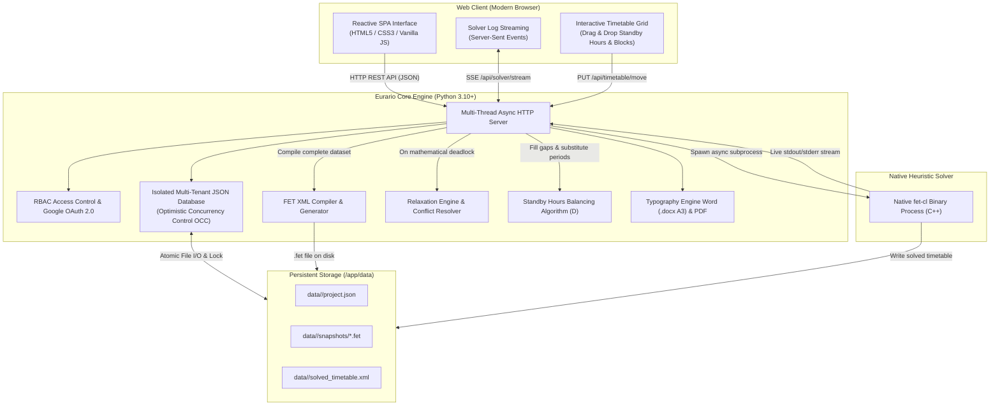
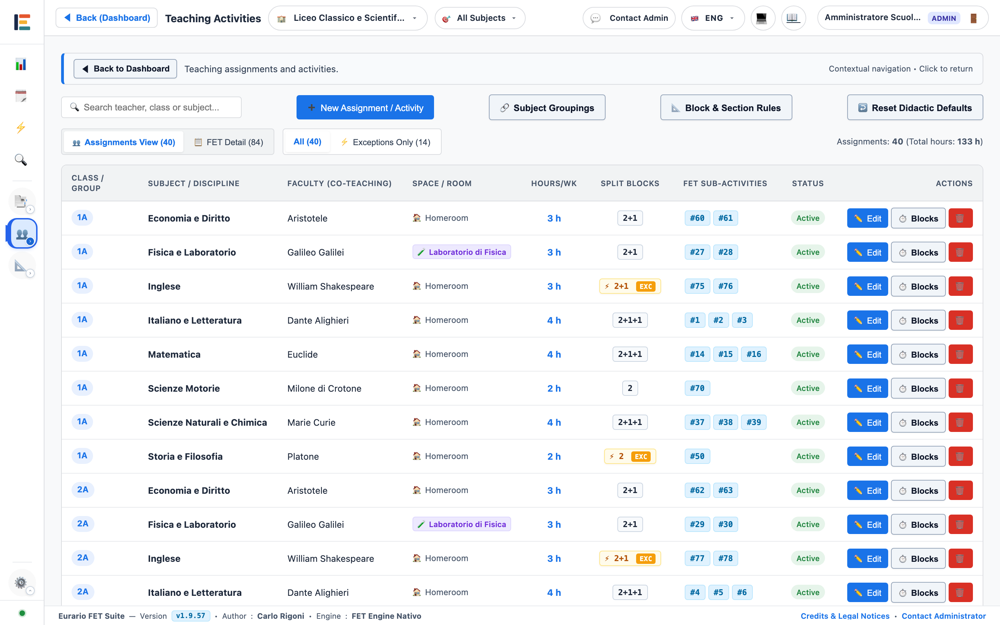

# 🎓 Eurario — Official Documentation

Welcome to the documentation for **Eurario**, the open-source suite designed to build, solve, optimize, and publish school timetables for secondary schools.

Eurario pairs a responsive Material Design 3 web client with the official native **FET** (*Free Timetabling Software*) heuristic engine developed by Liviu Lalescu and Volker Dirr.

---

## 🧭 Documentation Map

  <a href="getting-started/" class="eurario-card">
    <h3>🚀 Getting Started & Master Data</h3>
    
Google Workspace authentication, multi-school management, teachers, classes, subjects, rooms, and campuses.

  </a>

  <a href="user-guide/" class="eurario-card">
    <h3>📖 User Guide & Use Cases</h3>
    
Step-by-step operational guide in 14 chronological phases and 10 concrete use cases with interface screenshots.

  </a>

  <a href="timetable-flow/" class="eurario-card">
    <h3>⚡ Generation & Optimization Flow</h3>
    
Teaching loads, didactic block decomposition, asynchronous FET solver, Relaxation Engine, and standby periods.

  </a>

  <a href="cross-reference/" class="eurario-card">
    <h3>🔬 Parameters & FET Cross-Reference</h3>
    
Comprehensive mapping table between Eurario settings and compiled native C++ FET XML tags.

  </a>

  <a href="docker-deploy/" class="eurario-card">
    <h3>🐳 Docker Installation & Deployment</h3>
    
Deployment on Linux x86/ARM servers, Docker Compose recipes, Nginx, Caddy, and Cloudflare Tunnel.

  </a>

  <a href="architecture/" class="eurario-card">
    <h3>🏗️ Architecture & DevOps</h3>
    
GitHub and Docker Hub CI/CD pipelines, semantic versioning, and zero-downtime production upgrades.

  </a>

---

## 🏛️ System Architecture

Eurario uses a containerized modular architecture without external Python dependencies:

---

## 🌟 Key Features & Contractual Compliance

Eurario is built to satisfy educational constraints and Italian collective bargaining agreements (CCNL Scuola):

### 1. Teacher Contract Safeguards
* **Standard Loads (18 hours)**, **Part-time** (2 to 5 working days), and **Fractional loads**.
* **External Split Appointments (COE)**: Automatically deducts external days and hours from the weekly internal schedule.
* **Contractual Day Off**: Protected by a 100% hard constraint in the FET solver.
* **Idle Window Limits**: Strict daily (e.g., max 1) and weekly (e.g., max 2) gap limits.
* **Minimum Daily Hours**: Enforces a minimum load per active day (e.g., min 2 hours) to avoid inefficient one-hour trips.

### 2. Curriculum & Split Cohorts
* **Automatic Didactic Block Split**: Decomposes total subject hours into optimal blocks (`2+1+1` for 4 hours, `2+1` for 3 hours, `2+2+1+1` for 6 hours).
* **Macro-Subjects & Subject Merges**: Combines related subjects taught by the same teacher (e.g., *Math & Physics*).
* **Split Groups & Tracks**: Native support for language tracks (*French / Spanish*) and vocational specialties.
* **Preferred Time Slots**: Prioritizes early morning periods (*EARLY*) or afternoon periods (*LATE*).
* **Afternoon Block Exclusion**: Prohibits scheduling specified academic subjects during afternoon periods.

### 3. Multi-Campus Logistics & Shared Facilities
* **Main & Branch Campuses**: Manages road travel times and limits daily campus changes for traveling teachers.
* **Campus TimeMachine**: Hour-by-hour visual simulator with subway-style teacher commute routes.
* **Gymnasiums & Labs**: Tracks facility capacities to prevent room clashing.

### 4. Standby Periods & Substitution Coverage ("D")
* **Balancing Algorithm**: Assigns standby periods to close idle gaps and balance cover hours across every period.
* **Hourly Density Badges (`👥 X D`)**: Displays real-time counts of available standby teachers per period.
* **Drag & Drop Grid**: Allows manual fine-tuning with instant constraint checks.

### 5. Document Exports
* **Master Teacher Timetable Word (.docx A3 Landscape)**: Complies with official ministerial layouts with repeating header rows.
* **Student Class Schedules PDF**: High-contrast pastel palettes or monochrome toner-save output.
* **Optimistic Concurrency Control (OCC)**: Prevents accidental data overwrites when multiple committee members work concurrently.

---

## 🖥️ User Interface

  
  
Figure 1.1: Teaching loads management interface with automated didactic block breakdown.

---

## 📜 License & Project Credits

Eurario is open-source software released under the **GNU Affero General Public License v3 (AGPLv3)**.

* **Development & Architecture**: [Carlo Rigoni](https://github.com/carlorigoni)
* **Methodological Guidance**: Federico Rettore
* **FET Solver Engine**: Liviu Lalescu and Volker Dirr ([FET Official Website](https://lalescu.ro/liviu/fet/))
* **Official GitHub Repository**: [github.com/carlorigoni/eurario](https://github.com/carlorigoni/eurario)
