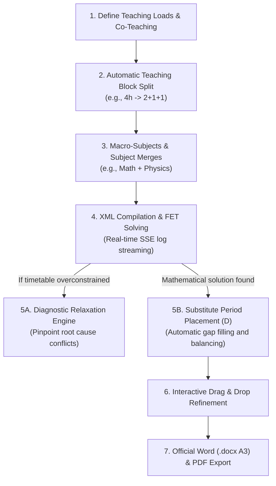
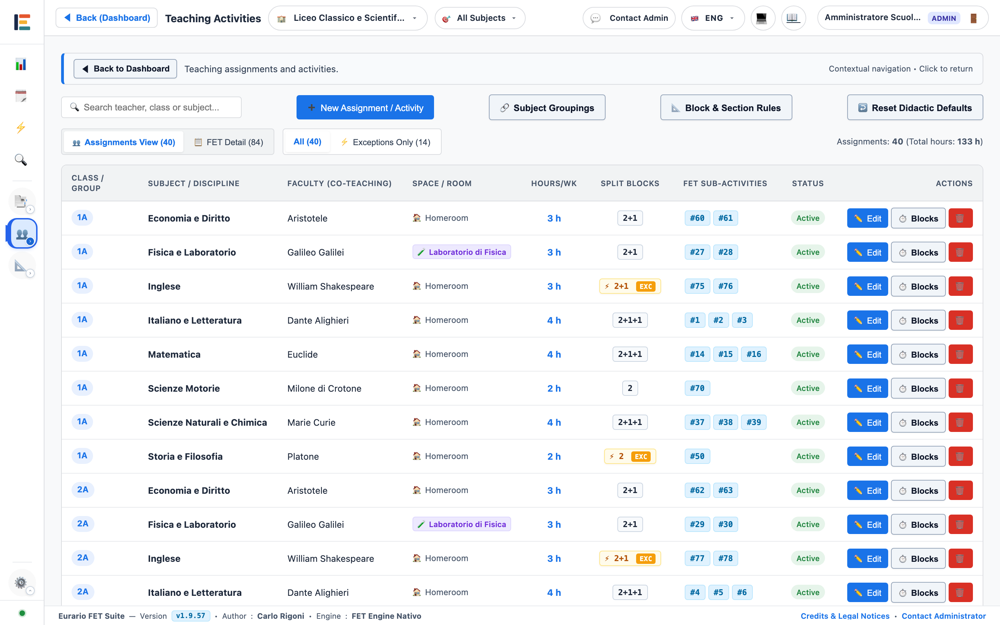
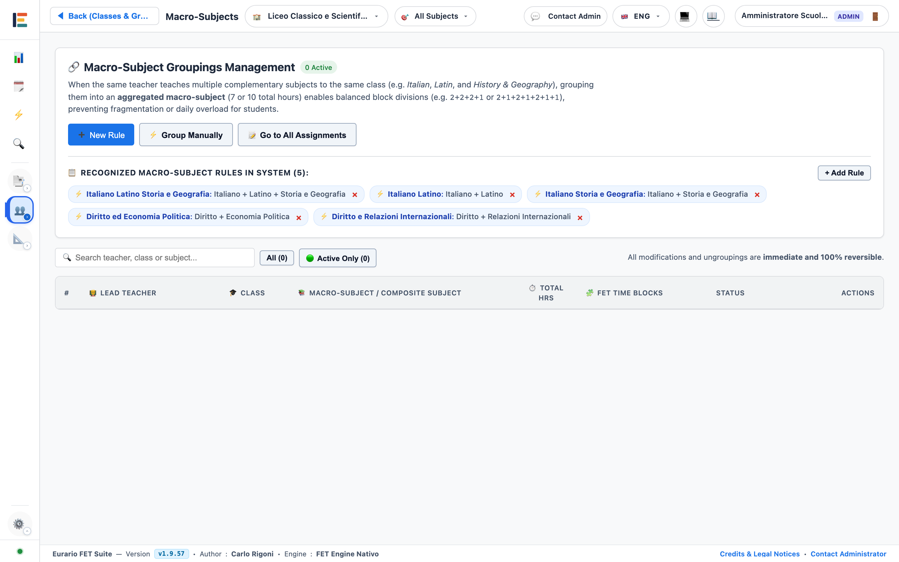
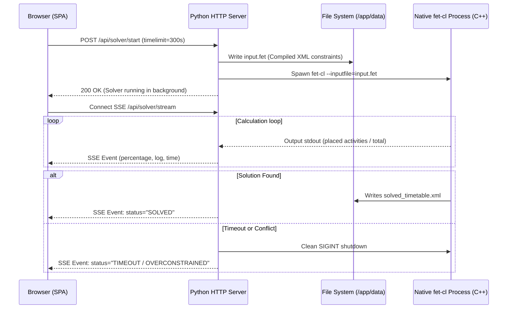
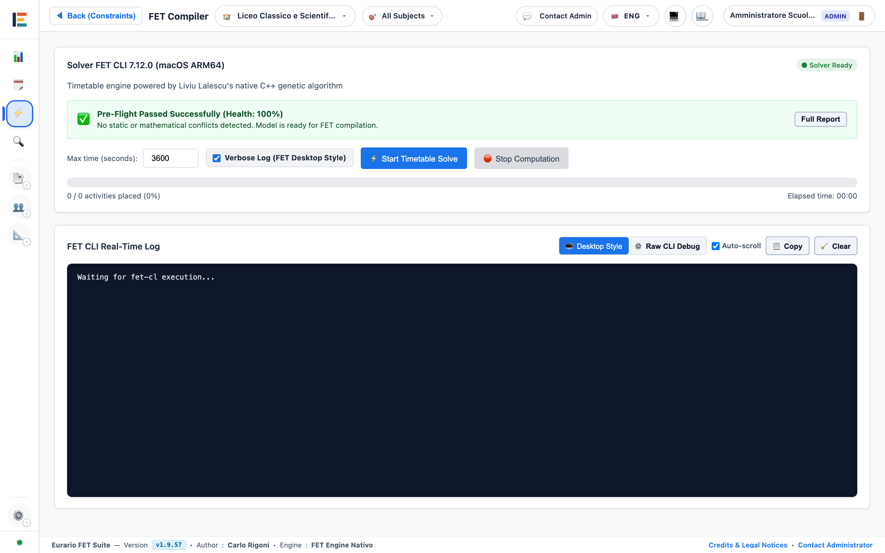
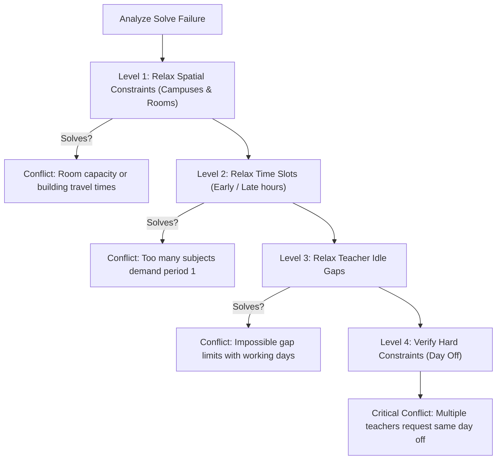
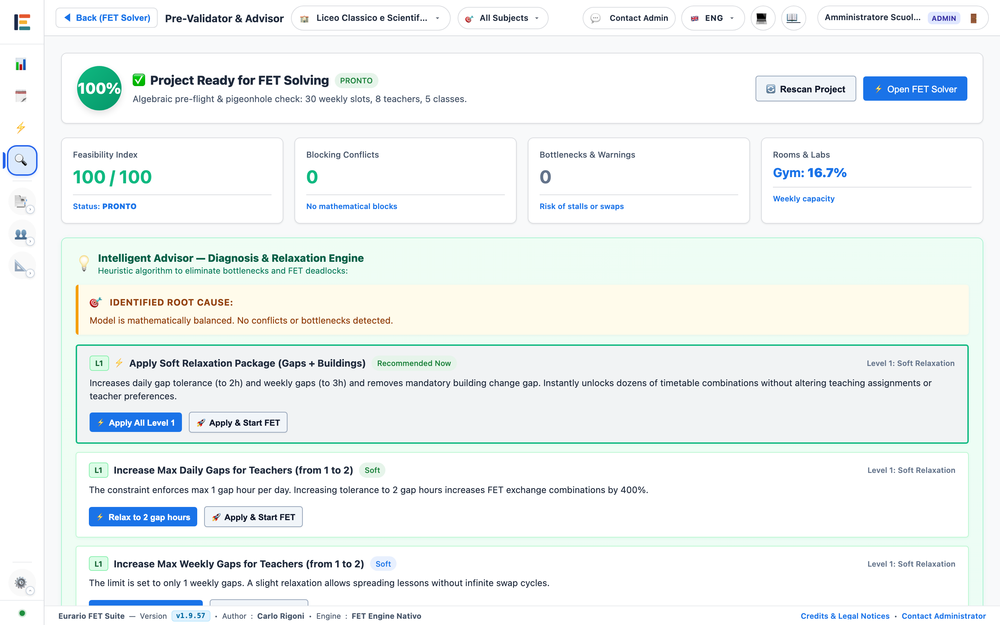
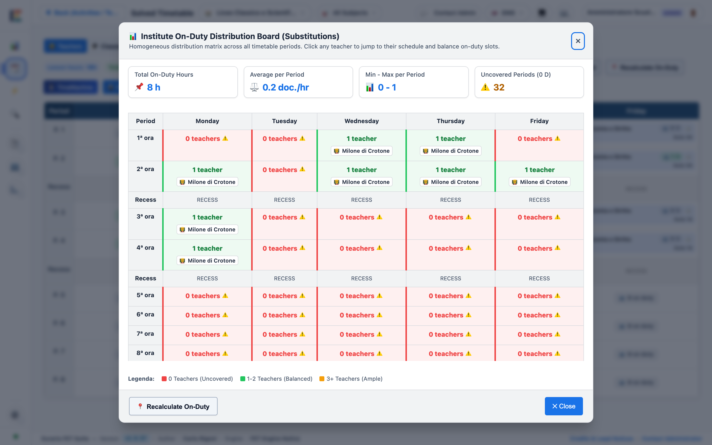
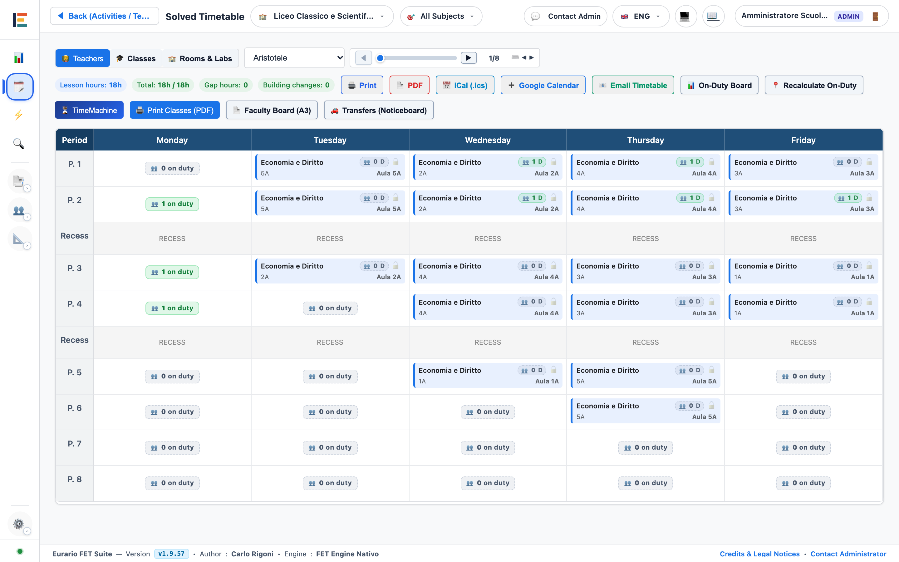
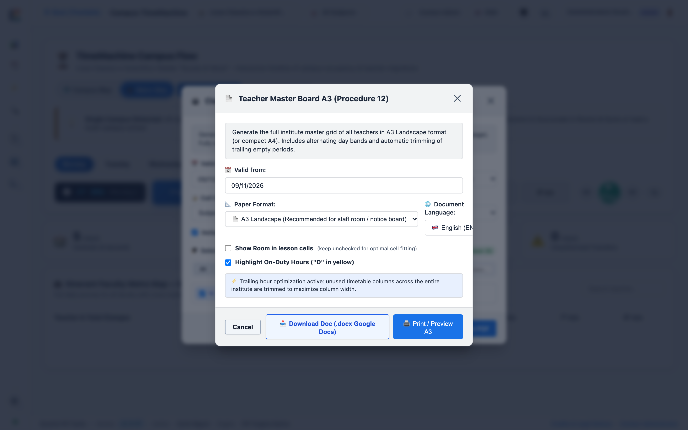

# ⚡ Timetable Generation & Optimization Flow

This operational guide describes the steps required to assemble, solve, and refine school timetables using the FET engine.

---

## 1. Teaching Loads & Didactic Block Split

### Purpose
Define weekly subject assignments and divide them into atomic units (blocks) for the FET solver.

### Automatic Block Split Rule
The FET engine schedules individual sub-activities. Eurario automatically decomposes weekly teaching hours using the `compute_fallback_blocks` heuristic:

| Weekly Hours | Default Breakdown | Typical Pedagogical Examples |
| :---: | :---: | :--- |
| **1 hour** | `1` | Religion, Alternative Ethics |
| **2 hours** | `2` *(or `1+1`)* | Physical Education, Art; oral subjects (`1+1`) |
| **3 hours** | `2+1` | Philosophy, Art History, English Language |
| **4 hours** | `2+1+1` *(or `2+2`)* | Mathematics, Physics; practical lab sessions (`2+2`) |
| **5 hours** | `2+1+1+1` *(or `2+2+1`)* | Italian Literature, Latin Language |
| **6 hours** | `2+2+1+1` | Humanities (Italian and History) |
| **7 hours** | `2+2+2+1` | Merged Math and Physics |
| **8 hours** | `2+2+2+2` | Vocational double laboratory courses |

  
  
Figure 2.1: Teaching loads interface with automatic block decomposition and feasibility checks.

### Procedure to Modify Hour Blocks
1. Open the **Teaching Loads (Cattedre)** tab from the main navigation.
2. Locate the row for the target subject and class.
3. Click the **Blocks** field (e.g., `2+1+1`).
4. Type the new block sequence (e.g., `1+1+1+1`).
5. Press `Enter` or click outside the field.
6. Verify that no sum warnings or teacher working day warnings appear.

> [!WARNING]
> The sum of all blocks must equal total contracted hours. The number of blocks cannot exceed the teacher's scheduled working days.

---

## 2. Macro-Subjects & Merging Rules

### Purpose
Combine related subjects taught by the same teacher to avoid scheduling conflicts and improve weekly balance.

  
  
Figure 2.2: Subject merge dialog for related disciplines (e.g., Math and Physics, Italian and History).

### Procedure to Merge Subjects
1. Open the **Teaching Loads** tab and click **Subject Merges**.
2. Review compatible candidates detected by Eurario (same teacher, same class).
3. Select the disciplines to combine (e.g., *Math* 4h + *Physics* 3h = 7h total).
4. Select the optimized block structure (e.g., `2+2+2+1`).
5. Click **Apply Merge**.

---

## 3. Asynchronous Resolution with the FET Engine

### Purpose
Compile constraints into native FET XML format and execute the background solver with live streaming progress.

  
  
Figure 2.3: Solver dashboard with live SSE log streaming and remaining computation time.

### Procedure to Run the Solver
1. Open the **Timetable Solver** tab from the main navigation.
2. Set the **Time Limit** in seconds (default `300` seconds).
3. Select the run mode:
   * **Full Solve**: recomputes all unlocked lesson cards.
   * **Resume from Highest Stage**: starts from the best partial solution.
4. Click **Start Solver**.
5. Monitor the progress bar and real-time streaming logs.
6. When the solve finishes successfully, click **View Timetable Board**.

---

## 4. Diagnostic Relaxation Engine (Conflict Resolver)

### Purpose
Automatically identify conflicting constraints when the timetable cannot be solved within the time limit.

  
  
Figure 2.4: Relaxation Engine diagnostic report with concrete corrective recommendations.

### Procedure for Diagnostic Analysis
1. If the solver reports `TIMEOUT`, click **Run Diagnostics**.
2. The engine executes 4 sequential levels of constraint relaxation.
3. Review the on-screen diagnostic report.
4. Identify the flagged teacher or class.
5. Apply the recommended correction (e.g., *change a teacher's day off* or *allow one additional gap hour*).
6. Restart the solver to verify the updated configuration.

---

## 5. Substitute Period Placement Algorithm ("D")

### Purpose
Automatically place contractual on-call standby periods ("D") to ensure complete substitution coverage throughout the school week.

### Contractual Residual Formula
$$\text{Standby Hours} = \text{target\_hours} - \sum \text{assigned curriculum hours}$$

### Three Priority Rules
1. **Priority 1 — Close Idle Gaps**: Places standby periods into existing free windows between lessons.
2. **Priority 2 — Natural Extension**: Schedules standby hours adjacent to lessons without extending the school day.
3. **Priority 3 — Weekly Balance**: Balances teacher coverage uniformly across every period of the week.

  
  
Figure 2.5: Weekly substitute coverage matrix with color-coded density indicators.

### Procedure to Place Standby Periods
1. Open the **Timetable Board** tab from the main navigation.
2. Click **Place Automatic Standby Hours**.
3. Eurario calculates optimal slots and places amber `D` badges into the grid.
4. Click **Standby Distribution** to inspect substitution coverage for every period.

---

## 6. Interactive Grid, Drag & Drop, and Activity Locking

### Purpose
Manually fine-tune the timetable and lock permanent lesson slots with 100% hard constraints.

  
  
Figure 2.6: Interactive timetable grid with drag and drop, density indicators, and slot locking (padlock).

### Procedure to Move Lessons (Drag & Drop)
1. Click and hold any lesson card or standby `D` badge.
2. Drag the card into the desired target slot.
3. Observe target cell highlights:
   * Green cells indicate valid placement without conflicts.
   * Red cells indicate teacher or room clashes.
4. Release the mouse button to confirm placement.

### Procedure to Lock a Lesson Slot (`Lock`)
1. Right-click the lesson card or click its menu button.
2. Select **Lock Slot (`Lock`)**.
3. A padlock icon `🔒` appears on the card.
4. The solver will keep this activity in place during future recalculations.

---

## 7. Official Document Export (Word & PDF)

### Purpose
Generate official documents for school notice boards and headmaster validation.

  
  
Figure 2.7: Export modal for Word (.docx A3 landscape) and PDF teacher schedules.

### Procedure to Export Schedules
1. On the **Timetable Board**, click **Export Prints**.
2. Select the target document format:
   * **Teacher Master Schedule Word (.docx A3 landscape)**: formatted to official ministerial guidelines.
   * **Class Timetables PDF**: rendered in soft pastel colors by subject.
   * **Campus Commute Summary**: weekly travel overview for multi-building schools.
3. Select desired options (e.g., *Include Standby Hours*, *Highlight Substitutes*).
4. Click **Download Document**.
