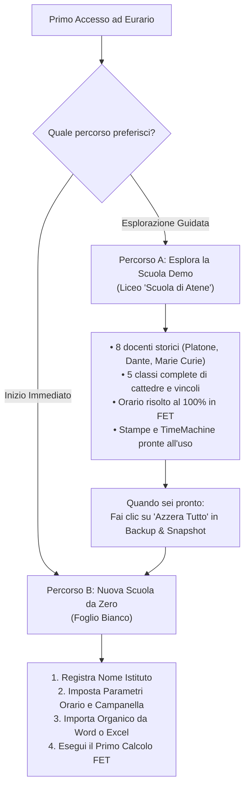
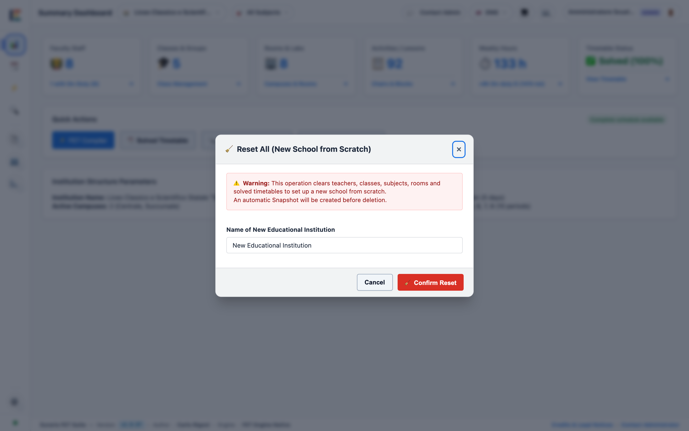
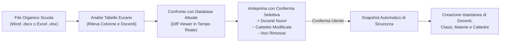
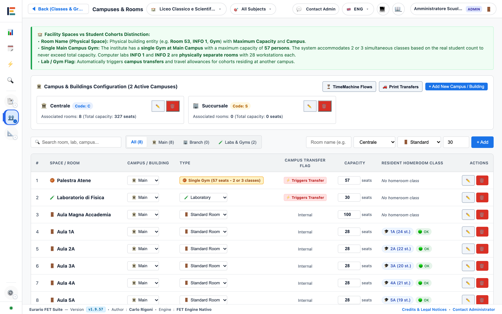

# 🚀 Primo Accesso & Configurazione Iniziale

Questa guida operativa accompagna la commissione orario nei primi passi all'interno di Eurario.

Segui le procedure numerate per creare un nuovo istituto, impostare i parametri fondamentali della scuola e importare l'organico del personale da file senza digitazione manuale.

---

## 1. Superare lo Shock da Foglio Bianco: Scelta della Strategia Iniziale

### Scopo
Familiarizzare con l'applicazione prima di configurare i dati reali della propria scuola oppure iniziare subito con una scuola pulita.

Eurario offre due percorsi operativi:

### Percorso A: Esplorare la Scuola Dimostrativa ("Scuola di Atene")
1. All'accesso iniziale, Eurario carica automaticamente l'istituto dimostrativo **Scuola di Atene**.
2. Consulta la scheda **Docenti** per osservare l'impostazione dei giorni liberi e delle cattedre.
3. Consulta la scheda **Tabellone** per visualizzare l'orario già calcolato al 100% con il motore FET.
4. Fai clic sul pulsante **TimeMachine** per osservare i flussi orari e gli spostamenti tra plessi.
5. In qualunque momento puoi ripristinare il dataset demo aprendo **Backup & Snapshot** &rarr; **Ripristina Demo ("Scuola di Atene")**.

  
  
Figura 1.1: Modale di ripristino istantaneo della scuola dimostrativa "Scuola di Atene" con orario precalcolato.

### Percorso B: Azzeramento a Foglio Bianco per una Nuova Scuola
Quando desideri iniziare a inserire i dati del tuo istituto scolastico:
1. Apri la scheda **Backup & Snapshot** dalla barra laterale.
2. Individua la sezione **Database Demo Didattici & Reset**.
3. Fai clic sul pulsante rosso **🧹 Azzera Tutto (Foglio Bianco)**.
4. Inserisci il nome del tuo istituto scolastico nel campo di testo.
5. Fai clic su **Conferma Svuotamento**.
6. Il sistema crea uno snapshot automatico di sicurezza e svuota docenti, classi e cattedre, lasciando l'ambiente pronto per la nuova scuola.

  
  
Figura 1.2: Modale di azzeramento a foglio bianco per avviare una scuola pulita da zero.

---

## 2. Creazione & Registrazione di un Nuovo Istituto (Multi-Scuola)

### Scopo
Creare un ambiente isolato e indipendente per una nuova scuola o per un diverso anno scolastico senza sovrascrivere altri progetti.

  
  
Figura 1.3: Modale di registrazione nuovo istituto con nome scuola, codice meccanografico e recapiti.

### Procedura di Registrazione
1. Fai clic sul menu a tendina **Istituti** nella barra superiore dell'applicazione.
2. Fai clic su **➕ Registra Nuovo Istituto...**.
3. Inserisci il **Nome Istituto Scolastico** (es. *Liceo Scientifico Statale "Galileo Galilei"*).
4. Inserisci il comune della scuola nel campo **Città / Comune**.
5. Inserisci il **Codice Meccanografico** ufficiale dell'istituto (es. `RMPS010004`).
6. Inserisci l'**Email Ufficiale** della segreteria o del referente della commissione orario.
7. Inserisci eventuali note organizzative nel campo **Note / Recapito Referente**.
8. Fai clic sul pulsante **🚀 Registra ed Entra**.
9. L'interfaccia si posiziona automaticamente nel nuovo istituto scolastico vuoto.

---

## 3. Parametri Fondamentali d'Istituto & Campanella

### Scopo
Definire la struttura temporale della settimana, gli orari della campanella e i vincoli contrattuali generali prima di inserire le lezioni.

> [!IMPORTANT]
> Configura i parametri d'istituto prima di comporre le cattedre. Il compilatore FET genera la matrice settimanale (giorni × ore) partendo esattamente da questi valori.

  
  
Figura 1.4: Schermata di configurazione parametri istituto, calendario settimanale, campanella e intervalli.

### Parametri Chiave da Configurare

| Sezione | Parametro | Valore Tipico | Descrizione Tecnica |
| :--- | :--- | :---: | :--- |
| **Calendario Settimanale** | Giorni di lezione | `5` o `6` giorni | 5 giorni per la settimana corta (Lun-Ven); 6 giorni con il Sabato. |
| **Ore Giornaliere** | Massimo ore al giorno | `6` ore | Numero massimo di unità orarie nella mattinata per studenti e docenti. |
| **Rientri Pomeridiani** | Ore pomeridiane | `0`, `1` o `2` | Attiva la 7ª e 8ª ora per scuole tecniche, professionali o licei musicali. |
| **Campanella** | Orario inizio 1ª ora | `08:00` | Orario di inizio della prima ora di lezione della mattina. |
| **Durata Unità Oraria** | Minuti per ora | `60` min | Durata della singola ora (es. 60 o 55 minuti). |
| **Intervallo Ricreazione** | Posizione e durata | Dopo la 3ª ora (15m) | Sospende le lezioni per la pausa ricreativa approvata dal collegio. |
| **Vincoli Docenti CCNL** | Max ore al giorno | `4` o `5` ore | Limita il carico giornaliero consecutivo per singolo docente. |
| **Vincoli Docenti CCNL** | Min ore al giorno | `2` ore | Evita uscite per 1 sola ora di lezione nei giorni lavorativi. |
| **Ore Buche Docenti** | Max buchi al giorno | `1` buco | Riduce le finestre vuote non retribuite nell'orario dei docenti. |
| **Ore Buche Docenti** | Max buchi a settimana | `2` o `3` buchi | Tetto settimanale complessivo di finestre vuote consentite a FET. |

### Procedura di Configurazione
1. Apri la scheda **Parametri Istituto** dal menu principale della barra laterale.
2. Seleziona la struttura della settimana: attiva o disattiva il **Sabato**.
3. Imposta l'orario di inizio e la durata delle ore di lezione.
4. Configura la collocazione dell'intervallo di ricreazione.
5. Imposta i tetti massimi per le ore buche giornaliere e settimanali.
6. Fai clic su **Salva Parametri**.

---

## 4. Importazione Rapida dell'Organico da File

### Scopo
Caricare l'intero organico docenti, le cattedre e le classi direttamente dai file della segreteria scolastica, azzerando i tempi di digitazione manuale.

### Metodo 1: Importazione da Modello Word Ufficiale (`.docx`)
Eurario fornisce un modello precompilato Word a 4 colonne conforme alla prassi delle segreterie scolastiche:

  
  
Figura 1.5: Modale di importazione e sincronizzazione organico da file Word (.docx) o Google Doc con download del template.

#### Procedura di Importazione Word
1. Apri la scheda **Cattedre** dal menu laterale.
2. Fai clic sul pulsante **Aggiorna da Word (.docx)**.
3. Se non possiedi il file formattato, fai clic su **📥 Scarica Modello Esempio (.docx)**.
4. Compila la tabella Word con le 4 colonne richieste:
   * **Classe di Concorso**: es. `A027`, `A012`, `A048`.
   * **Docente**: cognome e nome del docente (es. `Rossi Mario`).
   * **Classi**: elenco delle classi assegnate (es. `1A, 2A, 3B`).
   * **Ore**: ore settimanali per classe (es. `4, 4, 3`).
5. Trascina il file compilato nell'area di caricamento o fai clic su **Seleziona File Word**.
6. Esamina l'anteprima differenziale nel **Diff Viewer**:
   * Badge verdi: docenti o cattedre da inserire.
   * Badge gialli: variazioni di ore rispetto a dati preesistenti.
   * Badge rossi: docenti o cattedre non più presenti nel file.
7. Seleziona le caselle desiderate e fai clic su **Applica Modifiche Selezionate**.
8. Eurario crea automaticamente lo snapshot di sicurezza e popola il database.

### Metodo 2: Allineamento Cattedre & Contratti da Excel (`.xlsx` o CSV)
Per importare contratti completi di tipologia oraria (COE, Part-Time, Spezzoni e giorni di presenza):

  
  
Figura 1.6: Modale di allineamento tipologia cattedre da file Excel (.xlsx), CSV o testo incollato.

#### Struttura delle Colonne Excel Attese:
| Colonna 1 | Colonna 2 | Colonna 3 | Colonna 4 | Colonna 5 | Colonna 6 |
| :---: | :---: | :---: | :---: | :---: | :---: |
| **Classe Concorso** | **Docente** | **Classi Assegnate** | **Ore Settimanali** | **Tipo Cattedra** | **Giorni Presenza** |
| `A027` | Cartesio | 1A (4h), 2A (4h), 3A (4h) | 18 | `Intera` | `5` |
| `A012` | Omero | 4B (6h), 5B (6h) | 12 | `Part-Time` | `3` |
| `A048` | Archimede | 1A (2h), 2A (2h) | 10 (+8h est.) | `COE` | `3` |

#### Procedura di Allineamento Excel
1. Nella scheda **Cattedre**, fai clic sul pulsante **Allinea Cattedre (Excel / CSV)**.
2. Seleziona la scheda **📁 Carica File Excel (.xlsx) o CSV** oppure incolla direttamente le righe nella scheda **📋 Incolla Testo**.
3. Seleziona il file dal computer.
4. Fai clic su **Analizza File**.
5. Verifica la rilevazione automatica dei contratti part-time e COE.
6. Fai clic su **Applica Allineamento**.

---

## 5. Spazi Fisici Minimi (Plesso e Aule Base)

### Scopo
Garantire che ogni classe importata disponga di un edificio fisico e di un'aula base per le lezioni ordinarie.

  
  
Figura 1.7: Gestione plessi, aule ordinarie e laboratori specialistici.

### Procedura Minima di Configurazione Spazi
1. Apri la scheda **Spazi & Aule** dal menu principale.
2. Verifica che sia presente almeno un plesso principale (es. *Sede Centrale* con codice `C`).
3. Nella sezione **Aule & Laboratori**, crea un'aula base per ciascuna classe creata dall'importazione (es. *Aula 1A*, *Aula 2B*).
4. Assegna a ciascuna aula una capienza massima coerente con il numero di studenti.
5. Se la scuola dispone di spazi condivisi (es. *Palestra*, *Lab Informatica*), aggiungili contrassegnando la casella **Laboratorio o Palestra**.
6. Apri la scheda **Classi** e associa a ogni classe la propria aula base corrispondente.

---

## 6. Verifica Coerenza & Primo Test con il Solutore FET

### Scopo
Controllare che il monte ore delle classi sia didatticamente completo ed eseguire una prima risoluzione matematica per verificare l'assenza di incompatibilità.

  
  
Figura 1.8: Quadro generale cattedre con totale ore per classe e scomposizione automatica blocchi.

### Procedura di Verifica e Calcolo
1. Apri la scheda **Cattedre** e controlla i totali orari in fondo a ciascuna colonna di classe:
   * Le classi del biennio liceale devono totalizzare **27 ore**.
   * Le classi del triennio liceale devono totalizzare **30 ore**.
   * Gli istituti tecnici devono totalizzare **32 o 33 ore**.
2. Verifica che la scomposizione automatica dei blocchi (`2+1+1`, `2+2+1`, ecc.) sia congruente.
3. Apri la scheda **Solutore Orario** dalla barra laterale.
4. Imposta un tempo limite di **60 secondi**.
5. Fai clic sul pulsante **Avvia Solutore**.
6. Se i vincoli sono coerenti, FET completa la risoluzione in pochi secondi e apre la griglia del **Tabellone**.
7. Se il solutore segnala un conflitto o va in timeout, apri la scheda **Diagnostica** per leggere i suggerimenti del *Relaxation Engine*.
