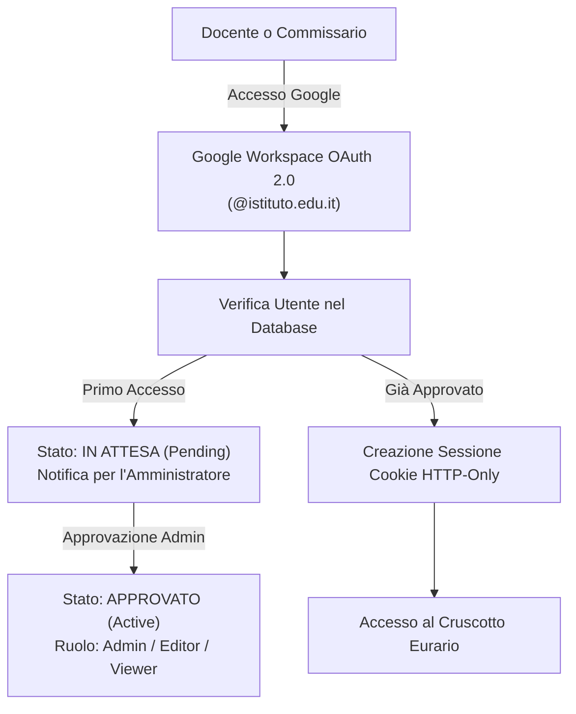
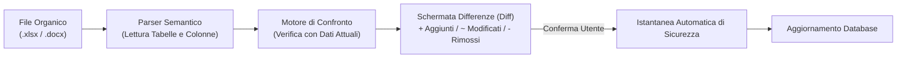

# 🚀 Primo Accesso & Configurazione Iniziale

Questa guida operativa descrive la configurazione iniziale di Eurario. Segui le procedure numerate per configurare l'autenticazione, gli spazi fisici, le classi, le materie didattiche e i docenti.

---

## 1. Autenticazione & Controllo Accessi (RBAC)

### Scopo
Proteggere i dati dell'istituto scolastico e assegnare i corretti privilegi operativi al personale autorizzato.

### Procedura di Primo Accesso
1. Apri l'indirizzo web di Eurario nel browser.
2. Fai clic sul pulsante **Accedi con Google**.
3. Seleziona il tuo account istituzionale con dominio della scuola (es. `@istituto.edu.it`).
4. Attendi l'approvazione da parte dell'amministratore di sistema.
5. Dopo l'approvazione, ricarica la pagina per entrare nel cruscotto.

  
  
Figura 1.1: Modale di gestione accessi, approvazione utenti e assegnazione ruoli RBAC.

### Ruoli Utente Disponibili
* **Admin**: Gestisce tutti gli istituti, approva gli accessi e modifica i parametri globali.
* **Editor**: Modifica anagrafiche, cattedre, vincoli ed esegue il solutore orario.
* **Viewer**: Consulta l'orario e scarica le stampe ufficiali senza permessi di scrittura.

> [!NOTE]
> Se la variabile `GOOGLE_CLIENT_ID` non è configurata nel server, Eurario si avvia in modalità standalone locale con accesso diretto senza login esterno.

---

## 2. Gestione Multi-Istituto (Multi-Tenant)

### Scopo
Gestire più scuole o anni scolastici distinti all'interno della stessa istanza del server.

### Caratteristiche del Modello Multi-Tenant
* **Isolamento dei Dati**: I file di ciascun istituto risiedono nella cartella `data/<school_id>/`.
* **Commutazione Rapida**: Seleziona il nome dell'istituto dal menu a tendina superiore.
* **Controllo Concorrenza Ottimistica (OCC)**: Ogni salvataggio incrementa il contatore `data_version`. Se due utenti salvano contemporaneamente, il sistema segnala il conflitto e mostra le differenze.

### Procedura per Creare un Nuovo Istituto
1. Fai clic sul selettore dell'istituto nella barra superiore.
2. Seleziona la voce **Nuovo Istituto...**.
3. Inserisci il nome ufficiale della scuola (es. *Liceo Statale Galileo Galilei*).
4. Scegli se creare un istituto vuoto oppure caricare il dataset dimostrativo *Scuola di Atene*.
5. Fai clic su **Crea Istituto**.

---

## 3. Anagrafica Plessi & Aule

### Scopo
Definire gli edifici fisici e gli spazi didattici prima di assegnare le attività alle classi.

  
  
Figura 1.2: Schermata gestione plessi, aule, laboratori e capienze.

### Procedura per Inserire un Plesso
1. Apri la scheda **Spazi & Aule** dal menu principale.
2. Individua la sezione **Plessi Scolastici**.
3. Fai clic sul pulsante **+ Nuovo Plesso**.
4. Inserisci il **Nome del Plesso** (es. *Sede Centrale*).
5. Inserisci il **Codice Breve** (es. `C`).
6. Imposta il **Tempo di Trasferimento** in minuti verso gli altri plessi.
7. Fai clic su **Salva Plesso**.

### Procedura per Inserire un'Aula o Laboratorio
1. Nella scheda **Spazi & Aule**, individua la sezione **Aule & Laboratori**.
2. Fai clic su **+ Nuova Aula**.
3. Inserisci il **Nome Aula** (es. *Lab Informatica 1* o *Palestra Grande*).
4. Seleziona il **Plesso di Appartenenza**.
5. Inserisci la **Capienza Studenti** massima.
6. Seleziona la **Tipologia Aula** (*Standard*, *Laboratorio*, *Palestra*).
7. Se l'aula è condivisa tra più classi, attiva la casella **Laboratorio o Palestra**.
8. Fai clic su **Salva Aula**.

> [!WARNING]
> Il tempo di trasferimento tra plessi deve coprire lo spostamento reale. Il solutore FET usa questo valore per impedire ore consecutive in plessi diversi senza pausa di viaggio.

---

## 4. Anagrafica Classi & Articolazioni

### Scopo
Definire le classi dell'istituto, le loro aule base e gli eventuali gruppi articolati.

  
  
Figura 1.3: Elenco classi, aula base assegnata e configurazione oraria settimanale.

### Procedura per Inserire una Classe Ordinaria
1. Apri la scheda **Classi** dal menu principale.
2. Fai clic su **+ Nuova Classe**.
3. Inserisci il **Nome Classe** (es. `1A`, `3CSA`).
4. Inserisci il **Numero Studenti**.
5. Seleziona l'**Aula Base** assegnata stabilmente alla classe.
6. Seleziona il **Plesso Predefinito**.
7. Scegli il preset settimanale (*Liceo 27h*, *Liceo 30h*, *Tecnico 32h*).
8. Fai clic su **Salva Classe**.

### Gestione dei Gruppi Articolati
Quando una classe si divide per discipline specifiche (es. *Francese / Spagnolo*):
1. Fai clic sul pulsante **Articolazioni** accanto alla classe.
2. Definisci i nomi dei sottogruppi (es. `3A_FRA` e `3A_SPA`).
3. Assegna l'aula o il laboratorio per ciascun sottogruppo.
4. Salva la configurazione. Le ore articolate si svolgono nella stessa fascia oraria in aule separate.

---

## 5. Anagrafica Materie Didattiche & Sigle

### Scopo
Configurare le discipline scolastiche, i codici CDC, le preferenze di fascia oraria e le sigle brevi per le stampe cartacee.

  
  
Figura 1.4: Modale di configurazione materia, classe di concorso, fascia oraria e sigla breve per stampe.

### Parametri della Disciplina
* **Nome Esteso**: Denominazione curricolare (es. *Scienze Naturali, Chimica e Geografia*).
* **Nome Breve (`short_name`)**: Sigla per le stampe Word e PDF (es. `SCI`, `MAT`, `ING`). Previene il testo su più righe nelle celle dell'orario.
* **Classe di Concorso (CDC)**: Codice ministeriale ufficiale (es. `A027`, `A012`).
* **Fascia Oraria Preferita (`pref_hours`)**:
  * `PRIME`: Priorità nelle prime 3 ore del mattino (prove scritte, calcolo).
  * `ULTIME`: Priorità nelle ore terminali o rientri (educazione motoria, laboratori pratici).
  * `INDIFFERENTE`: Nessun vincolo di posizione nella giornata.
* **Esclusione Rientri (`no_rientri`)**: Vieta la collocazione della materia nelle ore pomeridiane.

---

## 6. Anagrafica Docenti & Vincoli Contrattuali

### Scopo
Registrare i docenti con il proprio orario contrattuale, il giorno libero e le indisponibilità orarie.

  
  
Figura 1.5: Elenco docenti, monte ore cattedra, giorni di servizio e status disponibilità.

### Procedura per Configurare un Docente
1. Apri la scheda **Docenti** dal menu principale.
2. Fai clic su **+ Nuovo Docente** oppure seleziona un docente esistente.
3. Inserisci il **Nome Completo** (es. *Socrate*) e la **Sigla Breve** (es. *SOCRATE*).
4. Imposta il **Monte Ore Cattedra** (`target_hours`, es. `18` per cattedra intera).
5. Seleziona la **Tipologia Contratto** (*Intera*, *Part-time*, *Spezzone*).
6. Imposta i **Giorni Minimi e Massimi di Servizio** (`min_days` e `max_days`).
7. Se il docente completa l'orario in altra scuola, attiva la casella **Cattedra Orario Esterna (COE)** e indica le ore esterne.
8. Fai clic sulla matrice settimanale per contrassegnare il **Giorno Libero** o le ore indisponibili (caselle rosse).
9. Fai clic su **Salva Docente**.

  
  
Figura 1.6: Modale dettagliata per vincoli contrattuali, giorni presenza e plessi consentiti.

---

## 7. Importazione Automatica Organico da Excel o Word

### Scopo
Caricare l'intero organico docenti e le cattedre da file ufficiali senza digitazione manuale.

### Procedura di Importazione
1. Apri la scheda **Cattedre** dal menu principale.
2. Fai clic sul pulsante **Importa Organico**.
3. Seleziona il formato del file di origine:
   * **Foglio di Calcolo Excel (`.xlsx`)**: con colonne *Docente*, *CDC*, *Classe*, *Materia*, *Ore*.
   * **Documento Word Precompilato (`.docx`)**: scaricabile direttamente dal pulsante *Scarica Modello Word*.
4. Seleziona il file dal computer e conferma il caricamento.
5. Esamina la schermata di confronto (*Diff Viewer*):
   * Le righe verdi indicano nuove cattedre.
   * Le righe gialle indicano variazioni di ore.
   * Le righe rosse indicano assegnazioni cancellate.
6. Fai clic su **Applica Modifiche**. Il sistema genera uno snapshot automatico prima di salvare.
