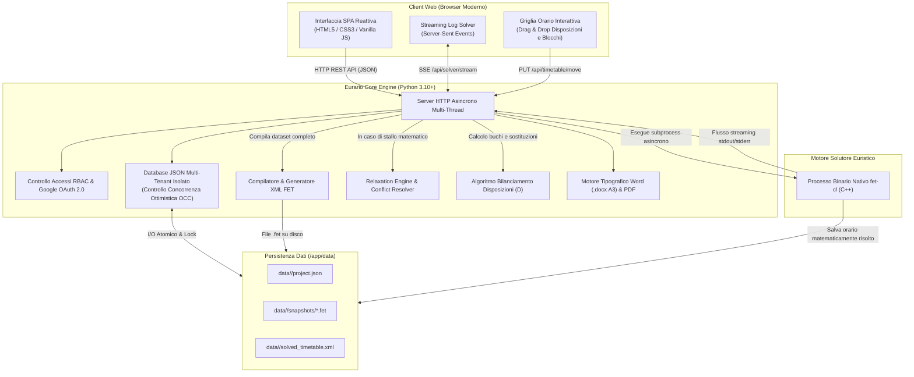

# 🎓 Eurario — Documentazione Ufficiale

Benvenuto nella documentazione di **Eurario**, la suite open source per progettare, calcolare, ottimizzare e pubblicare l'orario scolastico nelle scuole secondarie di primo e secondo grado.

Eurario integra un'interfaccia web responsive conforme a Material Design 3 con il motore solutore euristico nativo **FET** (*Free Timetabling Software*), sviluppato da Liviu Lalescu e Volker Dirr.

---

## 🧭 Navigazione Rapida della Guida

  <a href="getting-started/" class="eurario-card">
    <h3>🚀 Primo Accesso & Anagrafiche</h3>
    
Autenticazione con Google Workspace, gestione multi-istituto, anagrafiche docenti, classi, materie, aule e plessi.

  </a>

  <a href="user-guide/" class="eurario-card">
    <h3>📖 Guida Utente & Casi d'Uso</h3>
    
Guida operativa in 14 fasi cronologiche e 10 casi d'uso concreti con schermate di riferimento.

  </a>

  <a href="timetable-flow/" class="eurario-card">
    <h3>⚡ Flusso di Generazione & Ottimizzazione</h3>
    
Assegnazione cattedre, scomposizione blocchi didattici, solutore asincrono FET, Relaxation Engine e disposizioni.

  </a>

  <a href="cross-reference/" class="eurario-card">
    <h3>🔬 Parametri & Cross-Reference FET</h3>
    
Tavola comparativa tra i parametri di Eurario e i tag XML generati per il motore C++ FET.

  </a>

  <a href="docker-deploy/" class="eurario-card">
    <h3>🐳 Installazione & Deploy con Docker</h3>
    
Installazione su server Linux x86/ARM, configurazione Docker Compose, Nginx, Caddy e Cloudflare Tunnel.

  </a>

  <a href="architecture/" class="eurario-card">
    <h3>🏗️ Architettura & DevOps</h3>
    
Pipeline CI/CD con GitHub e Docker Hub, controllo di versione e aggiornamenti del server in produzione.

  </a>

---

## 🏛️ Architettura del Sistema

Eurario adotta un'architettura modulare containerizzata senza librerie esterne pesanti in Python:

---

## 🌟 Caratteristiche Chiave & Normativa CCNL

Eurario è progettato sulle regole contrattuali e didattiche della scuola italiana:

### 1. Rispetto dei Contratti Docenti
* **Cattedre Ordinarie (18 ore)**, **Part-time** (da 2 a 5 giorni settimanali) e **Spezzoni orari**.
* **Cattedre Orario Esterne (COE)**: Gestione di ore e giorni dedicati alla scuola di completamento.
* **Giorno Libero Contrattuale**: Tutela assoluta con vincolo rigido FET al 100%.
* **Controllo Ore Buche**: Limite massimo configurabile per giorno (es. max 1) e per settimana (es. max 2).
* **Minimo Ore Giornaliere**: Soglia minima di presenza (es. min 2 ore) per evitare spostamenti inefficienti.

### 2. Didattica e Articolazioni
* **Scomposizione Automatica in Blocchi Didattici**: Conversione automatica del monte ore in sequenze ottimali (`2+1+1` per 4 ore, `2+1` per 3 ore, `2+2+1+1` per 6 ore).
* **Macro-Materie & Accorpamenti**: Unione delle cattedre affini dello stesso docente (es. *Matematica e Fisica*).
* **Classi Articolate & Sdoppiamenti**: Supporto per lingue comunitarie (*Francese / Spagnolo*) e indirizzi tecnici.
* **Fasce Orarie Preferenziali**: Assegnazione prioritaria nelle prime ore (*PRIME*) o nelle ultime ore (*ULTIME*).
* **Esclusione Rientri Pomeridiani**: Divieto di collocazione nelle ore pomeridiane (7ª e 8ª ora).

### 3. Logistica Multi-Plesso & Aule Speciali
* **Centrale e Succursali**: Gestione dei tempi di trasferimento e limite sui cambi plesso giornalieri.
* **TimeMachine Plessi**: Simulatore ora per ora con mappa metropolitana dei docenti e monitoraggio spostamenti.
* **Palestre e Laboratori**: Capienza controllata e prevenzione di sovrapposizioni.

### 4. Disposizioni & Supplenze ("D")
* **Algoritmo di Bilanciamento**: Assegna le ore a disposizione per chiudere i buchi orari e distribuire la vigilanza.
* **Indicatori di Densità Oraria (`👥 X D`)**: Mostra in tempo reale il numero di docenti a disposizione presenti in ogni ora.
* **Griglia Drag & Drop**: Spostamento manuale delle ore con verifica immediata dei vincoli.

### 5. Esportazioni Tipografiche
* **Tabellone Docenti Word (.docx A3 Orizzontale)**: Conforme alla Procedura 12 con righe di intestazione ripetute.
* **Orario Classi PDF**: Impaginazione con colori pastello o modalità monocromatica per fotocopiatrici.
* **Controllo Concorrenza (OCC)**: Previene la sovrascrittura simultanea dei dati tra più utenti.

---

## 🖥️ Interfaccia Web

  
  
Figura 1.1: Schermata di gestione cattedre, assegnazione ore e scomposizione automatica in blocchi.

---

## 📜 Licenza & Crediti

Eurario è distribuito sotto licenza **GNU Affero General Public License v3 (AGPLv3)**.

* **Sviluppo & Architettura**: [Carlo Rigoni](https://github.com/carlorigoni)
* **Consulenza Metodologica**: Federico Rettore
* **Motore Euristico FET**: Liviu Lalescu e Volker Dirr ([Sito ufficiale FET](https://lalescu.ro/liviu/fet/))
* **Repository Ufficiale GitHub**: [github.com/carlorigoni/eurario](https://github.com/carlorigoni/eurario)
