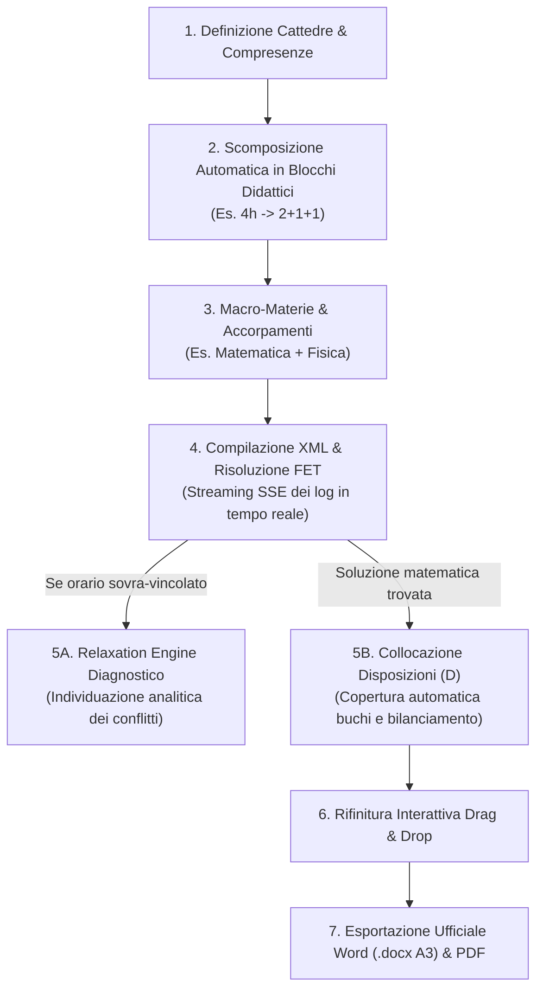
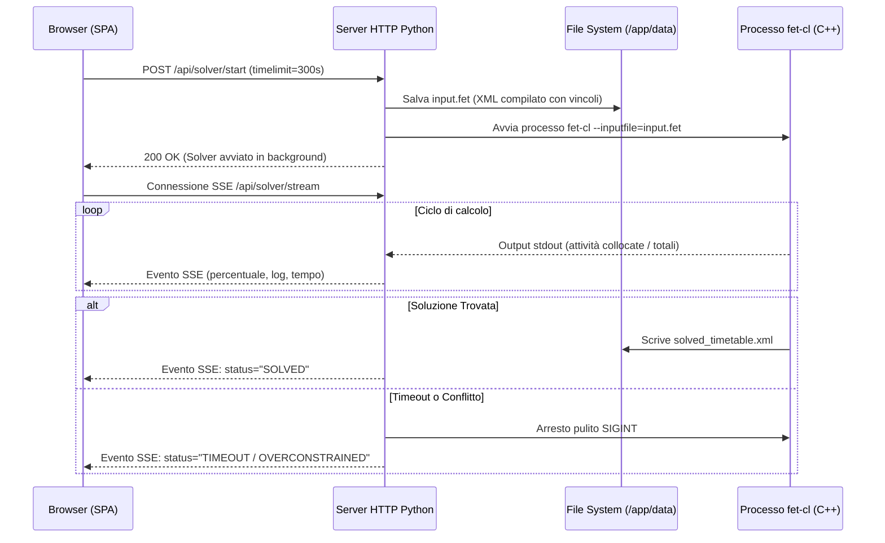
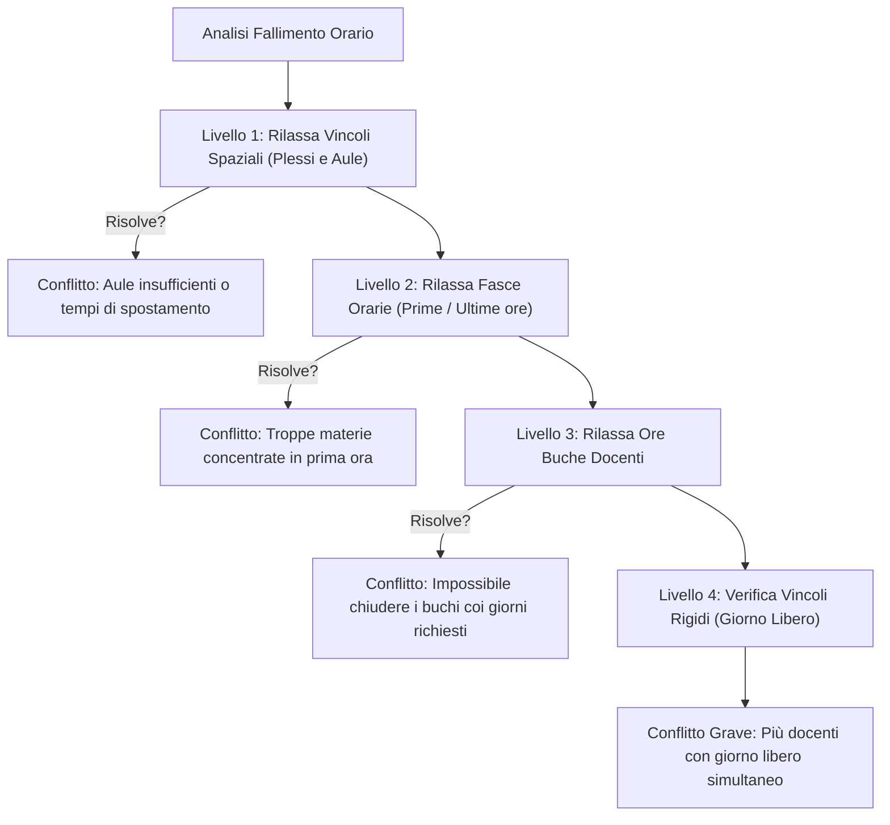

# ⚡ Flusso di Generazione & Ottimizzazione dell'Orario

Questa guida operativa descrive le fasi necessarie per comporre, calcolare e rifinire l'orario scolastico con il motore FET.

---

## 1. Definizione Cattedre & Scomposizione in Blocchi

### Scopo
Definire le assegnazioni didattiche settimanali e suddividerle in unità atomiche (blocchi) per il calcolo con FET.

### Regola di Scomposizione dei Blocchi
Il motore FET assegna singole sotto-attività (*Sub-activities*). Eurario scompone automaticamente il monte ore con la funzione `compute_fallback_blocks`:

| Ore Settimanali | Suddivisione Predefinita | Esempi Tipici & Varianti Didattiche |
| :---: | :---: | :--- |
| **1 ora** | `1` | Religione Cattolica, Materia Alternativa |
| **2 ore** | `2` *(oppure `1+1`)* | Scienze Motorie, Disegno; materie orali (`1+1`) |
| **3 ore** | `2+1` | Storia dell'Arte, Filosofia, Lingua Inglese |
| **4 ore** | `2+1+1` *(oppure `2+2`)* | Matematica/Fisica; Laboratori pratici (`2+2`) |
| **5 ore** | `2+1+1+1` *(oppure `2+2+1`)* | Italiano, Latino |
| **6 ore** | `2+2+1+1` | Lettere (Italiano e Storia) nel biennio |
| **7 ore** | `2+2+2+1` | Accorpamento Matematica e Fisica |
| **8 ore** | `2+2+2+2` | Discipline d'indirizzo professionale con doppio laboratorio |

  
  
Figura 2.1: Schermata cattedre con scomposizione automatica in blocchi didattici e verifica di fattibilità.

### Procedura di Modifica dei Blocchi
1. Apri la scheda **Cattedre** dal menu principale.
2. Individua la riga della materia e della classe interessata.
3. Fai clic sul campo **Blocchi** (es. `2+1+1`).
4. Digita la nuova sequenza desiderata (es. `1+1+1+1`).
5. Premi `Invio` o fai clic all'esterno del campo.
6. Verifica che non compaiano errori di somma o di compatibilità con i giorni del docente.

> [!WARNING]
> La somma dei blocchi deve essere uguale al totale delle ore della cattedra. Inoltre, il numero di blocchi non può superare i giorni di presenza contrattuale del docente.

---

## 2. Macro-Materie & Regole di Accorpamento

### Scopo
Unire materie affini affidate allo stesso docente per evitare conflitti e ottimizzare la distribuzione oraria.

  
  
Figura 2.2: Maschera di unione cattedre affini (es. Matematica e Fisica, Italiano e Storia).

### Procedura di Accorpamento
1. Apri la scheda **Cattedre** e fai clic sul pulsante **Accorpamenti**.
2. Il sistema elenca i candidati compatibili (stesso docente e stessa classe).
3. Seleziona le discipline da unire (es. *Matematica* 4h + *Fisica* 3h = 7h totali).
4. Scegli lo schema di scomposizione ottimizzato (es. `2+2+2+1`).
5. Fai clic su **Applica Accorpamento**.

---

## 3. Risoluzione Asincrona con Motore FET

### Scopo
Compilare i vincoli in formato XML ed eseguire il solutore nativo FET in background con monitoraggio in tempo reale.

  
  
Figura 2.3: Cruscotto di esecuzione solutore con log streaming SSE e tempo residuo.

### Procedura di Calcolo
1. Apri la scheda **Solutore Orario** dal menu principale.
2. Imposta il **Tempo Limite** in secondi (default `300` secondi).
3. Seleziona la modalità di avvio:
   * **Risoluzione Completa**: ricalcola tutte le lezioni non bloccate.
   * **Completa da Ultimo Stadio**: riprende dalla migliore soluzione parziale salvata.
4. Fai clic su **Avvia Solutore**.
5. Osserva la barra di avanzamento e i log streaming in tempo reale.
6. Al termine del calcolo con esito positivo, fai clic su **Visualizza Tabellone**.

---

## 4. Relaxation Engine Diagnostico (Risoluzione Conflitti)

### Scopo
Identificare in modo automatico i vincoli contrastanti quando il solutore non trova una soluzione valida.

  
  
Figura 2.4: Risultati della diagnostica Relaxation Engine con suggerimenti correttivi mirati.

### Procedura di Diagnostica
1. Se il solutore restituisce lo stato `TIMEOUT`, fai clic su **Diagnostica Conflitti**.
2. Il sistema esegue 4 livelli di rilassamento progressivo.
3. Leggi il report diagnostico a schermo.
4. Individua il docente o la classe segnalata dal sistema.
5. Applica la correzione suggerita (es. *modificare il giorno libero di un docente* o *aumentare le ore buche consentite*).
6. Riavvia il solutore per verificare la nuova configurazione.

---

## 5. Algoritmo di Collocazione delle Disposizioni ("D")

### Scopo
Assegnare in modo automatico e bilanciato le ore a disposizione contrattuali per le supplenze.

### Formula Residuo Contrattuale
$$\text{Ore Disposizione} = \text{target\_hours} - \sum \text{ore curricolari assegnate}$$

### I Tre Criteri di Priorità
1. **Priorità 1 — Chiusura Buchi Orari**: Assegna la disposizione negli intervalli vuoti tra due lezioni del docente.
2. **Priorità 2 — Accodamento Naturale**: Assegna la disposizione adiacente alle lezioni per non allungare la giornata.
3. **Priorità 3 — Bilanciamento Settimanale**: Distribuisce i docenti a disposizione in modo uniforme per garantire la vigilanza in ogni ora.

  
  
Figura 2.5: Matrice settimanale di copertura supplenze con indicatori cromatici di densità.

### Procedura per Collocare le Disposizioni
1. Apri la scheda **Tabellone** dal menu principale.
2. Fai clic sul pulsante **Colloca Disposizioni Automatiche**.
3. Il sistema calcola le posizioni e inserisce i badge `D` ambra negli slot disponibili.
4. Fai clic su **Distribuzione Disposizioni** per verificare la copertura in ogni ora della settimana.

---

## 6. Griglia Interattiva, Drag & Drop e Blocco Attività

### Scopo
Rifinire manualmente l'orario e bloccare gli slot definitivi con vincoli al 100%.

  
  
Figura 2.6: Griglia oraria interattiva con drag & drop, indicatori di densità e blocco slot (lucchetto).

### Procedura di Spostamento Manuale (Drag & Drop)
1. Fai clic e tieni premuto sul badge di una lezione o di una disposizione `D`.
2. Trascina la scheda nello slot di destinazione.
3. Osserva le celle evidenziate:
   * Le celle verdi indicano slot validi senza sovrapposizioni.
   * Le celle rosse indicano conflitti di docente o aula.
4. Rilascia la scheda per confermare lo spostamento.

### Procedura per Bloccare una Lezione (`Lock`)
1. Fai clic con il tasto destro sulla scheda della lezione o fai clic sull'icona delle opzioni.
2. Seleziona **Blocca Posizione (`Lock`)**.
3. Sulla scheda compare l'icona del lucchetto `🔒`.
4. Nei ricalcoli successivi, il solutore non sposterà questa attività.

---

## 7. Esportazione Stampe Ufficiali (Word & PDF)

### Scopo
Generare i documenti cartacei ufficiali per l'affissione a scuola e la firma del Dirigente Scolastico.

  
  
Figura 2.7: Modale per generazione tabellone docenti Word (.docx A3 orizzontale) e PDF.

### Procedura di Esportazione
1. Nel **Tabellone**, fai clic sul pulsante **Esporta Stampe**.
2. Scegli il tipo di documento:
   * **Tabellone Docenti Word (.docx A3 orizzontale)**: conforme alla Procedura 12 ministeriale.
   * **Orario per Classi PDF**: con palette cromatica per materia.
   * **Spostamenti Docenti tra Plessi**: riepilogo dei tempi di viaggio settimanali.
3. Seleziona le opzioni desiderate (es. *Includi Disposizioni*, *Evidenzia Supplenze*).
4. Fai clic su **Scarica Documento**.
