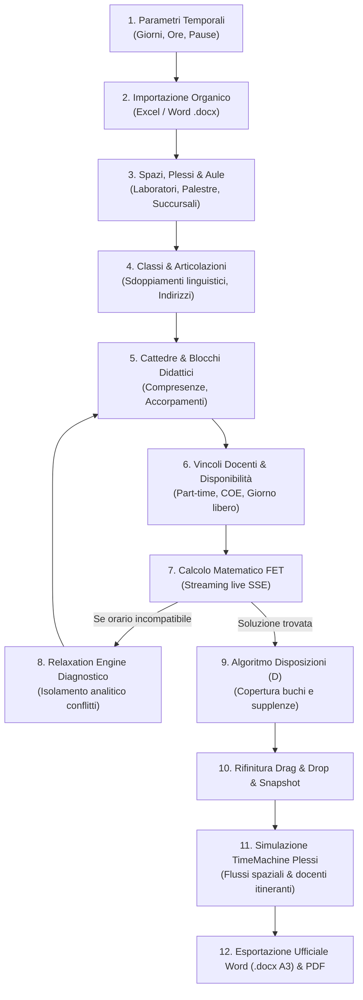
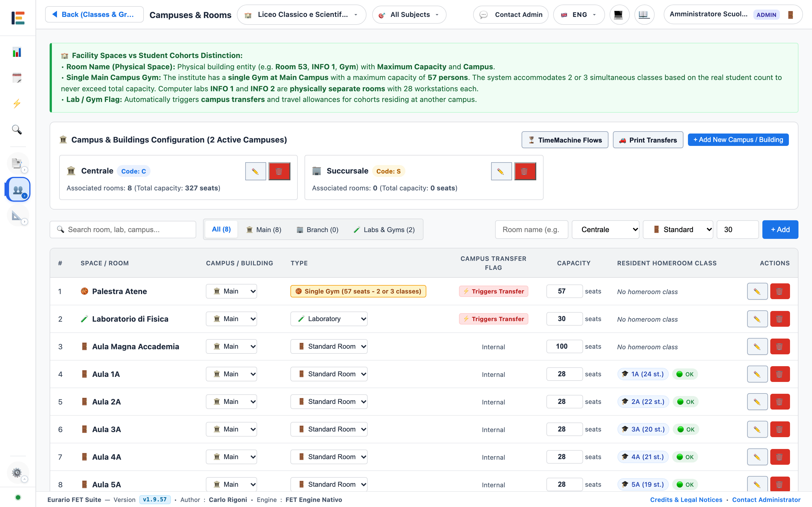
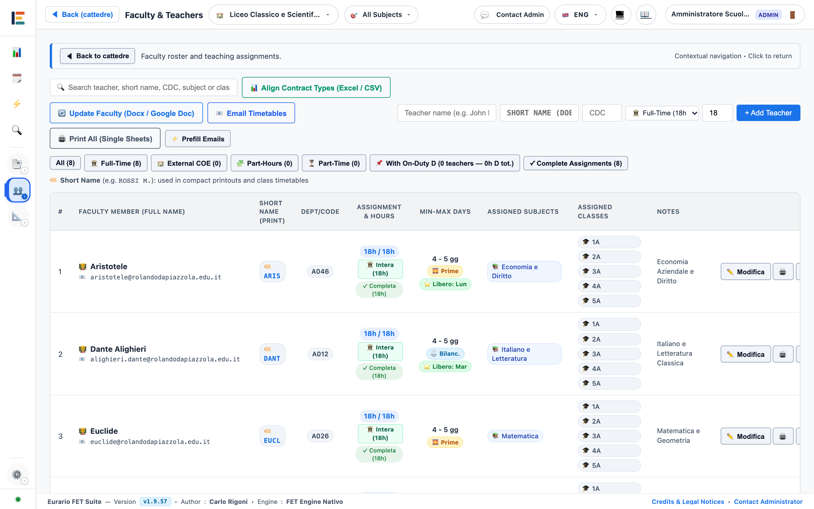
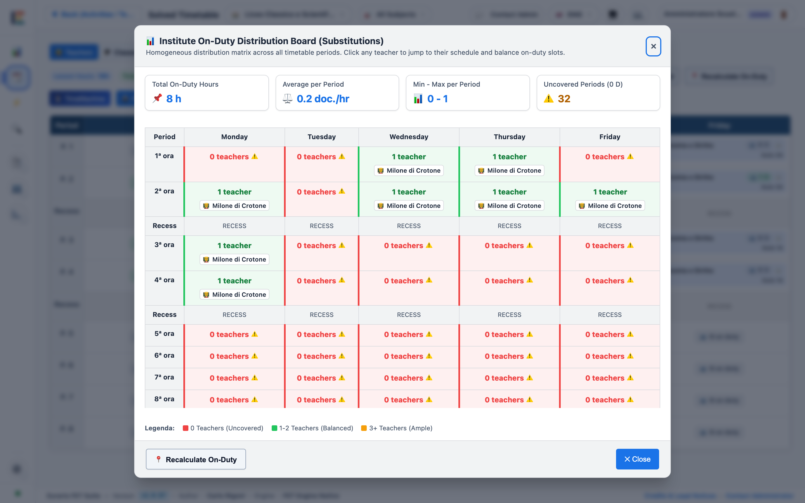
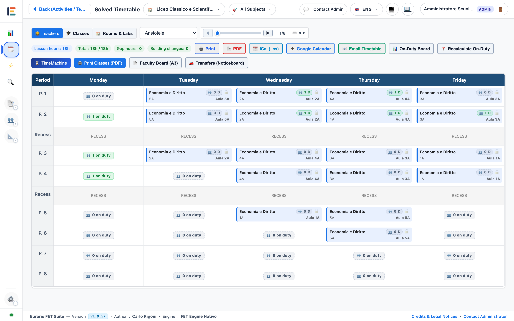
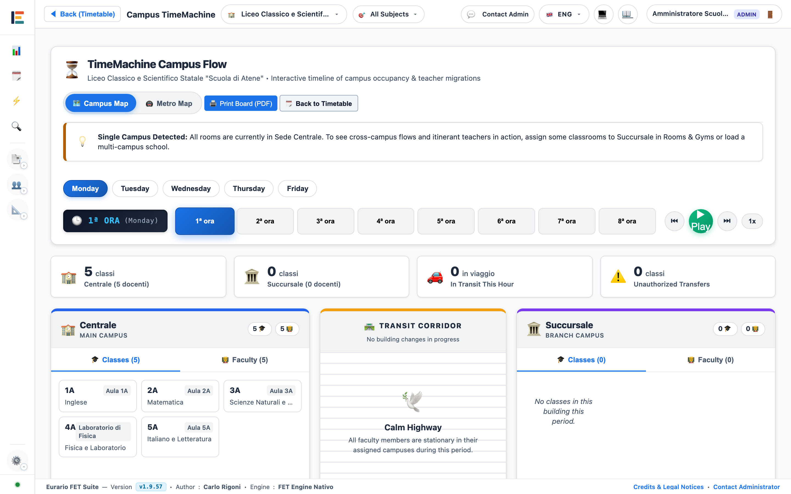

# 📖 Guida Utente Completa & Casi d'Uso Reali

La redazione dell'orario scolastico richiede il rispetto di vincoli contrattuali (CCNL Scuola), esigenze didattiche e limiti logistici. Questa guida fornisce istruzioni operative dirette, con periodi brevi e orientati all'azione secondo i principi di scrittura tecnica controllata (ASD-STE100).

Tutte le schermate illustrate in questa guida utilizzano il dataset demo didattico **Scuola di Atene**.

---

## 🗺️ Il Flusso Operativo End-to-End

---

### Fase 1: Configurazione Temporale dell'Istituto

**Scopo:** Definire la struttura settimanale di base prima di inserire classi o docenti.

1. Apri il menu **Impostazioni Orario**.
2. Seleziona **Giorni della Settimana**:
   * Scegli *Settimana Corta* (5 giorni, Lunedì–Venerdì).
   * Oppure scegli *Settimana Tradizionale* (6 giorni, Lunedì–Sabato).
3. Imposta **Ore di Lezione Giornaliere** (es. 6 ore ordinarie: 08:00–14:00).
4. Abilita i **Rientri Pomeridiani** (7ª e 8ª ora) se il piano di studi li prevede.
5. Inserisci la posizione dell'**Intervallo Didattico** (es. dopo la 3ª ora) per applicare la pausa globale.

---

### Fase 2: Ingestione e Allineamento dell'Organico

**Scopo:** Caricare docenti e cattedre da file esterni senza inserimenti manuali.

1. Apri la schermata **Snapshot & Organico**.
2. Fai clic su **Carica File Organico**.
3. Seleziona il file Excel (`.xlsx`), CSV o il modello Word (`.docx`).
4. Esamina il riquadro di verifica differenziale (Visual Diff):
   * 🟢 **Verde**: Docenti o assegnazioni nuove.
   * 🟡 **Giallo**: Cattedre con ore settimanali modificate.
   * 🔴 **Rosso**: Cattedre rimosse.
5. Fai clic su **Applica Modifiche con Snapshot**. Il sistema crea un punto di ripristino prima di aggiornare i dati.

---

### Fase 3: Modellazione degli Spazi e dei Plessi

**Scopo:** Registrare edifici, aule e laboratori con i relativi vincoli logistici.

1. Registra i **Plessi (Buildings)**:
   * Crea le sedi della scuola (es. *Centrale* e *Succursale*).
   * Imposta il tempo di trasferimento stradale tra le sedi (es. 15 minuti).
2. Aggiungi le **Aule Ordinarie** associando ciascuna al proprio plesso.
3. Registra gli **Spazi Specialistici** (palestre, aule informatiche, laboratori).
4. Attiva l'opzione **Laboratorio o Palestra** (`is_lab_or_gym`) per le risorse condivise tra più classi.

---

### Fase 4: Classi, Indirizzi e Gruppi Articolati

**Scopo:** Creare le classi dell'istituto e configurare gli sdoppiamenti disciplinari.

1. Registra le classi ordinarie (es. `1A`, `2B`, `3CSA`).
2. Inserisci il numero di studenti per controllare la capienza delle aule.
3. Seleziona l'**Aula Base (Home Room)** assegnata stabilmente alla classe.
4. Per le classi articolate (es. sdoppiamento di lingua straniera), crea i sottogruppi collegati (es. `3A_FRA` e `3A_SPA`).

---

### Fase 5: Cattedre, Blocchi Didattici e Accorpamenti

**Scopo:** Associare docenti, materie e classi definendo la scomposizione oraria settimanale.

1. Assegna a ogni cattedra il docente, la classe, la materia e le ore settimanali.
2. Controlla la suddivisione automatica in blocchi didattici:
   * 4 ore $\rightarrow$ blocco `2+1+1`.
   * 6 ore $\rightarrow$ blocco `2+2+1+1`.
   * 2 ore di Scienze Motorie $\rightarrow$ blocco unico `2` in palestra.
3. Apri il modulo **Accorpamenti** per unire materie affini dello stesso docente nella stessa classe (es. *Matematica e Fisica* 7h $\rightarrow$ `2+2+2+1`).

---

### Fase 6: Vincoli Docenti, Desiderata e Riservatezza

**Scopo:** Configurare monte ore contrattuale, giorni liberi, preferenze orarie e token di riservatezza.

1. Verifica il monte ore contrattuale (`target_hours`: 18h per cattedra intera, o valore ridotto per part-time).
2. Imposta il numero minimo e massimo di giorni di servizio (`min_days` e `max_days`).
3. Nella **griglia disponibilità settimanale**, contrassegna in rosso le ore di indisponibilità assoluta o il giorno libero.
4. Per docenti con cattedra mista, attiva la spunta **COE** e indica le ore esterne.
5. Nella modale parametri, visualizza il **Link Calendario Privato (Token Segreto)** con i pulsanti per copiare il link o rigenerare la chiave crittografica.

---

### Fase 7: Elaborazione con il Solutore Matematico FET

**Scopo:** Avviare la risoluzione algoritmica automatica dei vincoli orari.

1. Apri la schermata **Calcolo Orario & Solver**.
2. Imposta il limite di tempo desiderato (es. 300 secondi o illimitato).
3. Fai clic su **Avvia Solutore FET**.
4. Monitora la barra di avanzamento e i log in tempo reale via SSE.
5. Se necessario, interrompi il calcolo: il sistema salva lo stadio parziale più avanzato.

---

### Fase 8: Risoluzione Diagnostica con il Relaxation Engine

**Scopo:** Isolare i vincoli incompatibili quando l'orario risulta matematicamente non risolvibile.

1. Quando il calcolo si arresta, apri il report del **Relaxation Engine**.
2. Leggi il livello gerarchico del conflitto individuato (Livello 1: ore assolute, Livello 2: aule, Livello 3: buche e giorni).
3. Applica la correzione minima suggerita nella scheda del docente o della classe.
4. Riavvia il calcolo con FET.

---

### Fase 9: Collocazione Intelligente e Monitoraggio delle Disposizioni ("D")

**Scopo:** Assegnare le ore a disposizione dei docenti per coprire buchi orari e garantire supplenze.

1. Fai clic su **Colloca Disposizioni Automatiche**. L'algoritmo riempie le ore buche e ottimizza la copertura delle supplenze.
2. Controlla gli indicatori di densità (`👥 X D`) visibili in ogni cella libera dell'orario:
   * **`0 D` (Grigio)**: Nessun docente a disposizione in quell'ora (finestra scoperta critica).
   * **`1-2 D` (Verde)**: Copertura ottimale per le supplenze.
   * **`3+ D` (Viola)**: Alta densità di personale a disposizione.
3. Fai clic su **📊 Quadro Disposizioni** per aprire la matrice settimanale completa.
4. Fai clic sulla pillola di un docente per passare direttamente al suo orario individuale.

---

### Fase 10: Revisione Fine Interattiva e Tabellone Orario

**Scopo:** Spostare le ore manualmente, bloccare le posizioni confermate ed esportare i formati orario.

1. Apri la vista **Orario Risolto**.
2. Trascina qualsiasi card di lezione con **Drag & Drop** per cambiarne la collocazione.
3. Fai clic sull'icona del lucchetto (`🔒`) per **bloccare in modo permanente** una lezione (`locked="true"`). Le attività bloccate mantengono una cornice blu più spessa e non vengono modificate dai successivi ricalcoli FET.
4. Fai clic su **Salva Snapshot** per archiviare la versione confermata.
5. Utilizza i pulsanti in testata:
   * **🖨️ Stampa A4**: Anteprima stampabile della scheda docente.
   * **📄 PDF**: Download istantaneo del PDF vettoriale A4.
   * **📅 iCal (.ics)**: Download del file calendario standard RFC 5545.
   * **➕ Google Calendar**: Iscrizione automatica con un clic al calendario docente.
   * **📧 Invia Email**: Apertura della procedura di invio individuale.

---

### Fase 11: Validazione Spazio-Temporale con la TimeMachine Plessi

**Scopo:** Verificare i flussi di movimento tra le sedi e il comfort degli spostamenti per i docenti itineranti.

1. Apri la schermata **⏳ TimeMachine Plessi**.
2. Usa i tasti freccia o il pulsante **▶ Play** per simulare lo scorrimento della giornata ora per ora.
3. Controlla il **Corridoio di Transito**: verifica che nessun docente abbia cambi sede consecutivi senza intervallo o ora buca intermedia (badge ⚠️ *Ore Consecutive*).
4. Ispeziona il pannello **🌅 Inizio Fuori Sede** per rilevare le classi con prima ora in succursale.
5. Fai clic su **🚇 Mappa Metro** per visualizzare la linea temporale dei trasferimenti settimanali.

---

### Fase 12: Esportazione Ufficiale Word (.docx) e PDF

**Scopo:** Generare i documenti ufficiali per l'albo, i docenti e le classi.

1. Apri il menu **Stampe Ufficiali**.
2. Seleziona **Tabellone Docenti Word (.docx)**:
   * Genera il documento in formato **A3 Orizzontale** conforme alla Procedura 12 ministeriale.
   * Mantiene le intestazioni ripetute automaticamente su ogni foglio.
   * Evidenzia in colore ambra le ore a disposizione ("D").
3. Seleziona **Orari Classi PDF**:
   * Genera il documento A4 per classe con codici cromatici per materia o in versione monocromatica per bacheca.

---

### Fase 13: Notifica Riservata Docenti, Allegati PDF e Sincronizzazione Calendario (Google & iCal)

**Scopo:** Consegnare a ogni docente esclusivamente il proprio orario individuale nel rispetto della riservatezza (Zero-Confronti Privacy).

1. **Invio Email Individuale**:
   * Ciascun docente riceve un'email contenente **esclusivamente il proprio orario settimanale** nel corpo del messaggio.
   * È possibile selezionare singoli docenti o lanciare l'invio globale all'intero collegio.
2. **Prova Preventiva per l'Amministratore**:
   * Invia un'email di prova al tuo indirizzo per verificare layout, grafica e connessione SMTP prima dell'invio massivo.
3. **Allegato PDF Vettoriale A4 Ufficiale**:
   * Ogni email include il file allegato `Orario_{Cognome_Nome}.pdf` pronto per la stampa.
4. **Allegato iCalendar (.ics) con Ricorrenza Settimanale**:
   * Ogni email include il file `Orario_{Cognome_Nome}.ics` conforme allo standard RFC 5545 con ricorrenza settimanale fino al termine dell'anno scolastico (parametro d'istituto configurabile, predefinito 8 giugno).
5. **Sincronizzazione con 1 Clic (Google Calendar / Apple / Outlook)**:
   * Nel corpo del messaggio, il pulsante **➕ Aggiungi a Google Calendar** apre Google Calendar e iscrive il docente al feed.
   * Il pulsante **🍏 Apple Calendar / Outlook (Webcal)** configura i dispositivi iOS, macOS e Outlook.
6. **Protezione Crittografica e Riservatezza dei Feed**:
   * Ogni URL di calendario include un token segreto casuale a 128 bit (`?token=...`).
   * Richieste senza token o con token errato ricevono **`403 Forbidden`**. Questo impedisce tentativi di visualizzare orari di altri docenti alterando il nome nell'URL.
   * L'amministratore può visualizzare il link privato o rigenerare la chiave crittografica nella scheda docente revocando i vecchi collegamenti.

---

### Strumenti Trasversali di Produttività & Supporto

#### 1. Filtro Globale Multi-Materia in Testata
Posizionato nella barra superiore dell'applicazione (`topbar`), consente di filtrare l'intero ambiente di lavoro in base a una o più discipline:
* **Selezione Multipla con Ricerca Rapida**: Permette di spuntare contemporaneamente più materie (es. *Matematica* e *Fisica*, oppure tutte le lingue straniere).
* **Filtro Persistente e Trasversale**: L'impostazione rimane attiva navigando tra le varie maschere del programma (*Cattedre*, *Attività*, *Orario Risolto*), isolando automaticamente docenti, classi e cattedre pertinenti.
* **Azioni Rapide**: Pulsanti dedicati *Seleziona Tutte* e *Deseleziona Tutte / Azzera Filtro* con conteggio attivo visibile sul chip in testata.

#### 2. Copresenze Didattiche con Materie Indipendenti
Nei corsi tecnici e professionali con ore di laboratorio in compresenza:
* **Materie Autonome per Ciascun Docente**: Il docente di teoria e l'insegnante tecnico-pratico (ITP) possono essere associati alla stessa attività con materie distinte (es. *Informatica* per il teorico e *Laboratorio di Informatica* per l'ITP).
* **Nessuna Forzatura**: Eurario rispetta la denominazione ufficiale di cattedra di ciascun docente, garantendo la corretta attribuzione oraria nei conteggi contrattuali e nelle stampe ufficiali.

#### 3. Canale di Assistenza "Contatta Amministratore"
Accessibile dalla barra superiore (`topbar`), dal footer di pagina e dalla schermata iniziale:
* **Ticket e Feedback Integrati**: Consente a docenti, oristi o collaboratori del dirigente di inoltrare rapidamente richieste di variazione orario, segnalazioni tecniche o suggerimenti direttamente all'amministratore del sistema.

---

## 💼 Casi d'Uso Reali Approfonditi (Scuola Italiana & Manuale Ufficiale FET)

Prima di addentrarsi nei singoli casi pratici, è fondamentale richiamare l'**architettura e filosofia algoritmica** illustrata nel [Manuale Ufficiale FET](https://www.timetabling.de/manual/FET-manual.en.html), adottata integralmente dal motore di Eurario.

### 🧠 I Tre Pilastri Algoritmici del Manuale Ufficiale FET

#### 1. La "Regola Aurea" (The Golden Rule) e la Generazione Incrementale
Un orario scolastico è un problema matematico di classe NP-completo. L'errore più comune delle commissioni orario consiste nel caricare contemporaneamente fin dal primo tentativo la totalità dei vincoli, desiderata individuali e preferenze di ogni docente. Se il calcolo non converge, risulta quasi impossibile identificare quale regola sia responsabile del conflitto.
* **Fase A (Scheletro Strutturale 100%)**: Inserire unicamente entità e vincoli inderogabili: Giorni, Ore, Classi, Docenti, Cattedre curricolari, Indisponibilità assolute (giorni liberi contrattuali, part-time) e Aule obbligatorie (laboratori specialistici e palestre). Convalidare che questo scheletro converga in pochi secondi. Se fallisce, esiste un'incongruenza aritmetica nell'organico (es. ore assegnate a una classe superiori al monte ore settimanale della griglia).
* **Fase B (Qualità Didattica e Benessere)**: Introdurre i vincoli di cadenza settimanale (`Min days between activities`), il tetto di ore consecutive per docente (`Max hours continuously`) e il tetto massimo di ore buche settimanali (`Max gaps per week`).
* **Fase C (Ottimizzazioni Soft e Desiderata)**: Aggiungere preferenze orarie (es. ingressi/uscite richieste), limitazione al nomadismo tra aule diverse o raggruppamenti particolari.

#### 2. La Meccanica dei Pesi dei Vincoli ($0.0\% - 100.0\%$)
Nel solutore FET ogni vincolo possiede un attributo percentuale di peso (`Weight_Percentage`):
* **Vincoli Rigidi (100% Hard Constraints)**: Costituiscono regole binarie assolute. Il motore di ricerca di FET non accetterà mai un orario che violi anche un solo vincolo al 100%. Se due vincoli al 100% entrano in contraddizione logica, l'algoritmo entrerà in uno stallo matematico infinito.
* **Vincoli Flessibili (Soft Constraints: es. 85%, 95%, 99%)**: Rappresentano preferenze ottimali. Durante lo scambio euristico ricorsivo (*heuristic recursive swapping*), FET può temporaneamente e circoscrittamente violare un vincolo soft pur di completare il piazzamento delle attività rimanenti. Un vincolo impostato al 98% o 99% consente a FET di generare una soluzione didatticamente impeccabile in decine di secondi, dove un rigido 100% provocherebbe stallo.

#### 3. Isolamento degli Stalli Matematici
Come documentato dagli sviluppatori Liviu Lalescu e Volker Dirr nel manuale di FET, il fallimento del calcolo non è mai casuale ma deriva da un sovra-vincolamento circolare (*over-constrained model*). Eurario integra a tal fine il **Relaxation Engine**, che disattiva ricorsivamente i vincoli soft e analizza i log di conflitto per isolare esattamente i docenti o le classi coinvolte nel vicolo cieco.

---

### Caso d'Uso 1: Docente con Cattedra Orario Esterna (COE)
* **Contesto**: Il Prof. Marco Bianchi (A027, Matematica e Fisica) ha una cattedra di 18 ore complessive: **12 ore** nella scuola principale e **6 ore esterne** in un istituto vicino, dove presta servizio il **Martedì e Giovedì**.
* **Procedura in Eurario**:
  1. Nella scheda Docente, impostare `target_hours: 18`.
  2. Attivare la spunta **Cattedra Orario Esterna (COE)**.
  3. Impostare `Ore Esterne: 6`. Eurario calcola automaticamente che la scuola deve assegnare esattamente $18 - 6 = 12$ ore interne.
  4. Nella matrice delle disponibilità settimanali, cliccare su tutte le ore del **Martedì** e del **Giovedì** per contrassegnarle in rosso (indisponibili).
  5. Impostare `max_days: 3` (Lunedì, Mercoledì, Venerdì).
* **Risultato FET**: FET traduce l'impostazione nel vincolo `<ConstraintTeacherNotAvailableTimes>` al 100% per Martedì e Giovedì e colloca le 12 ore interne rigorosamente nei restanti 3 giorni, senza possibilità di errore.

---

### Caso d'Uso 2: Docente Part-Time Verticale (10 Ore su 3 Giorni)
* **Contesto**: La Prof.ssa Laura Conti (A012, Lettere) usufruisce di un part-time contrattuale al 55% per 10 ore settimanali, con l'accordo di prestare servizio su **massimo 3 giorni alla settimana**. Ha due classi con cattedre da 6 ore e 4 ore.
* **Procedura in Eurario**:
  1. Nella scheda Docente, impostare `target_hours: 10`, `contract_type: part-time`.
  2. Impostare `max_days: 3` e `min_days: 3`.
  3. Suddivisione dei blocchi:
     * Cattedra 6 ore: blocco `2+2+2` (anziché `2+2+1+1` che richiederebbe 4 giorni!).
     * Cattedra 4 ore: blocco `2+2` (anziché `2+1+1` che richiederebbe 3 giorni!).
  4. Eurario esegue il controllo preventivo `check_cattedra_feasibility`: verifica che i 3 blocchi della cattedra 1 e i 2 blocchi della cattedra 2 possano convivere nei 3 giorni concordati.
* **Risultato FET**: FET impone `<ConstraintTeacherMaxDaysPerWeek>3</ConstraintTeacherMaxDaysPerWeek>` e concentra il carico didattico (es. 4h + 3h + 3h = 10h) esattamente nei 3 giorni lavorativi concordati.

---

### Caso d'Uso 3: Cattedra Accorpata di Indirizzo (Matematica e Fisica 7 Ore)
* **Contesto**: Nel triennio del Liceo Scientifico (classe 3B), la cattedra di A027 prevede **4 ore di Matematica** e **3 ore di Fisica**, affidate entrambe al medesimo docente. Gestire le materie separatamente genererebbe vincoli concorrenti e blocchi sub-ottimali.
* **Procedura in Eurario**:
  1. Nel menu **Regole di Accorpamento**, cliccare su **Cerca Candidati**.
  2. Il sistema riconosce che il docente insegna Matematica e Fisica nella classe 3B per complessive 7 ore.
  3. Cliccare su **Applica Accorpamento**:
     * Eurario crea una macro-cattedra da 7 ore con scomposizione didattica automatica `2+2+2+1`.
     * Distribuisce i blocchi su 4 o 5 giorni della settimana.
  4. Nei tabelloni di stampa ufficiali, grazie alle sigle brevi (`MAT`, `FIS`), ogni singola ora viene etichettata correttamente con la rispettiva disciplina.

---

### Caso d'Uso 4: Classe Articolata per Lingue Straniere (Francese e Spagnolo)
* **Contesto**: Nella classe 2A (Liceo Linguistico), 14 studenti studiano Francese (Prof.ssa Dubois) e 12 studenti Spagnolo (Prof. Martinez). Le lezioni devono tenersi contemporaneamente nelle stesse 3 ore settimanali, ma in aule diverse.
* **Procedura in Eurario**:
  1. Nella scheda **Classi & Gruppi**, selezionare la classe `2A` e cliccare su **Aggiungi Articolazione**:
     * Creare il sottogruppo `2A_FRA` (14 studenti) con aula preferita `Aula 105`.
     * Creare il sottogruppo `2A_SPA` (12 studenti) con aula preferita `Lab Linguistico`.
  2. Assegnare la cattedra di Francese 3h (`2+1`) al sottogruppo `2A_FRA`.
  3. Assegnare la cattedra di Spagnolo 3h (`2+1`) al sottogruppo `2A_SPA`.
* **Risultato FET**: FET riconosce che i sottogruppi appartengono alla stessa classe radice e sincronizza le lezioni nelle medesime ore (`ConstraintTwoActivitiesGrouped` / partizione studenti), garantendo che la classe 2A non abbia sovrapposizioni orarie e che ciascun gruppo occupi la propria aula dedicata.

---

### Caso d'Uso 5: Compresenza Didattica in Laboratorio (Teorico + ITP)
* **Contesto**: Nella classe 4A Informatica, l'insegnamento di *Sistemi e Reti* (4 ore settimanali) prevede per 2 ore settimanali la compresenza del docente di teoria (Prof. Verdi, CDC A041) e dell'Insegnante Tecnico Pratico (Prof. Neri, CDC B016) all'interno del *Laboratorio Reti*.
* **Procedura in Eurario**:
  1. Creare una prima attività curricolare da 2 ore singole (`1+1`) affidata al solo Prof. Verdi in aula ordinaria.
  2. Creare una seconda attività da 2 ore consecutive (`2`) affidata **simultaneamente** al Prof. Verdi e al Prof. Neri (selezionando entrambi i docenti nel campo cattedra).
  3. Associare a quest'ultima attività l'aula obbligatoria `Laboratorio Reti`.
* **Risultato FET**: FET compila un'unica attività con `<Teacher>Verdi</Teacher>` e `<Teacher>Neri</Teacher>`, vincolando entrambi i docenti alla presenza congiunta nel medesimo slot e riservando il laboratorio senza possibilità di conflitto.

---

### Caso d'Uso 6: Gestione Multi-Plesso con Tempi di Viaggio (Centrale e Succursale)
* **Contesto**: Un istituto tecnico ha la Sede Centrale e la Sede Succursale a 4 km di distanza (circa 20 minuti di tragitto). 6 docenti insegnano classi in entrambe le sedi.
* **Procedura in Eurario**:
  1. In **Plessi**, registrare `Centrale` e `Succursale`.
  2. Nelle impostazioni di trasferimento, impostare `Travel Time: 20 min` e `Max Cambi Plesso al Giorno: 1`.
  3. Assegnare a ciascuna classe l'edificio di appartenenza.
* **Risultato FET**: FET attiva:
  * `<ConstraintTeachersMaxBuildingChangesPerDay>`: Vieta al docente di cambiare sede più di una volta al giorno.
  * `<ConstraintTeachersMinGapsBetweenBuildingChanges>`: Se un docente deve spostarsi dalla Centrale alla Succursale, FET impone obbligatoriamente un'ora buca intermedia per consentire lo spostamento in sicurezza.

---

### Caso d'Uso 7: Palestre Condivise e Risorse a Capienza Limitata
* **Contesto**: L'istituto dispone di una sola palestra di grandi dimensioni, che può ospitare al massimo 2 classi contemporaneamente (divisa da tenda divisoria), per complessive 40 ore disponibili a settimana. Le classi totali dell'istituto sono 24 (ciascuna con 2 ore settimanali di Scienze Motorie = 48 ore richieste).
* **Procedura in Eurario**:
  1. Registrare due aule distinte: `Palestra Campo A` e `Palestra Campo B` (ciascuna con capienza 30 studenti).
  2. Inserire le cattedre di Scienze Motorie (blocco `2`) per ciascuna classe, indicando come aule consentite sia `Palestra Campo A` sia `Palestra Campo B`.
  3. Eurario calcola preliminarmente il bilancio di saturazione: $24 \text{ classi} \times 2\text{h} = 48\text{ ore}$ a fronte di $2 \text{ campi} \times 30\text{ ore/settimana} = 60\text{ ore}$ disponibili. Poiché $48 \le 60$, il calcolo è teoricamente realizzabile con un margine del 20%.
* **Risultato FET**: FET distribuisce le ore sulle due metà campo (`ConstraintActivityPreferredRooms`) senza mai superare la contemporaneità di due classi in palestra.

---

### Caso d'Uso 8: Risoluzione di un Orario Sovra-Vincolato con il Relaxation Engine
* **Contesto**: Lanciando il calcolo con FET, il solutore raggiunge il 94% delle attività ma si blocca in stallo matematico (*Over-constrained Timetable*).
* **Procedura di Diagnosi in Eurario**:
  1. La schermata di Eurario visualizza il report del **Relaxation Engine**.
  2. Il motore diagnostico indica:
     > *"Conflitto individuato al Livello 3 (Ore buche e giorni di servizio): Il Prof. Ferrari ha 18 ore assegnate su 4 classi, giorno libero il Venerdì, e vincolo di massimo 1 ora buca settimanale. Tuttavia, due delle sue classi non hanno lezioni il Lunedì per rientro pomeridiano."*
  3. **Azione Correttiva**: Nella scheda del Prof. Ferrari, la commissione porta temporaneamente il limite da 1 ora buca a 2 ore buche settimanali, oppure sposta il giorno libero al Giovedì.
  4. Al successivo avvio del solutore, FET trova la soluzione ottima in 35 secondi.

---

### Caso d'Uso 9: Collocazione Ottimizzata delle Ore di Disposizione ("D")
* **Contesto**: Il Prof. Alberto Galli ha una cattedra di 15 ore curricolari. Da contratto a 18 ore, deve effettuare **3 ore a disposizione** della scuola per supplenze e vigilanza.
* **Procedura in Eurario**:
  1. Una volta ottenuto l'orario curricolare risolto, cliccare su **Colloca Disposizioni Automatiche**.
  2. L'algoritmo di Eurario analizza l'orario del Prof. Galli:
     * Trova un buco alla 3ª ora del Martedì (tra la 2ª e la 4ª ora): assegna qui la prima ora di disposizione, chiudendo il buco.
     * Accoda la seconda disposizione alla 5ª ora del Mercoledì dopo le sue lezioni ordinarie.
     * Posiziona la terza disposizione alla 1ª ora del Venerdì per rafforzare la copertura supplenze all'ingresso.
  3. La commissione desidera che la disposizione del Venerdì sia impiegata per il coordinamento dei laboratori: apre la cella e digita nella nota personalizzata (`custom_desc`): *"Coord. Lab Info"*.
  4. Clicca sull'icona del lucchetto: la cella diventa protetta (`locked`) da qualsiasi futuro ricalcolo.

---

### Caso d'Uso 10: Gestione dell'Orario Provvisorio vs Definitivo tramite Snapshot
* **Contesto**: All'apertura dell'anno scolastico (metà settembre), l'istituto adotta un **orario provvisorio a 4 ore giornaliere** senza rientri pomeridiani e con alcuni docenti supplenti non ancora nominati. A metà ottobre, a organico completato, si passa all'**orario definitivo a 6 ore**.
* **Procedura in Eurario**:
  1. **Configurazione Provvisoria**: Impostare 4 ore al giorno, escludere temporaneamente le cattedre scoperte e lanciare FET.
  2. Salvare lo stato cliccando su **Crea Snapshot** con il nome *"2026_09_Orario_Provvisorio_4h"*.
  3. Scaricare il file `.fet` generato come backup storico.
  4. **Passaggio al Definitivo**:
     * Nel menu Impostazioni, estendere la giornata scolastica a 6 ore (e rientri).
     * Completare l'assegnazione dei nuovi docenti nominati dall'ufficio scolastico.
     * Lanciare il solutore FET per l'orario definitivo completo.
     * Salvare lo snapshot *"2026_10_Orario_Definitivo_Ufficiale"*.
  5. In caso di necessità (es. ritardo nell'arrivo dei docenti o ordinanza sindacale), è possibile ripristinare istantaneamente con un solo clic l'orario provvisorio precedente.

---

### Caso d'Uso 11: Attività Quindicinali / a Settimane Alterne (Cattedre Asimmetriche)
* **Riferimento Manuale FET**: Sezione *Add a fortnightly activity*.
* **Contesto**: Nel biennio, l'insegnamento di *Tecnologia e Disegno* prevede 1 ora settimanale teorica in aula ordinaria e 1 ora di laboratorio informatico svolta a settimane alterne (settimana A / settimana B), per un totale reale di 1,5 ore settimanali oppure 1 ora ogni 15 giorni. In alternativa, una classe ha 1 ora quindicinale di approfondimento con il docente di lettere.
* **Le Due Soluzioni del Manuale FET**:
  1. **Soluzione 1 (Workaround pratico raccomandato dal manuale)**: Inserire l'attività come curricolare regolare ma vincolarla a bordo giornata:
     * Assegnare all'attività il vincolo `<ConstraintActivityEndsStudentsDay>` oppure una preferenza d'orario sulla prima/ultima ora della giornata.
     * In questo modo, nella settimana in cui la lezione quindicinale non ha luogo, gli studenti non rimangono con un'ora buca nel mezzo della mattinata, ma entrano semplicemente un'ora dopo o escono un'ora prima.
  2. **Soluzione 2 (Accoppiamento speculare)**: Se due materie quindicinali diverse (es. *Disegno CAD* e *Laboratorio Chimica*) o due gruppi diversi (es. 1A e 1B) condividono il medesimo docente o laboratorio:
     * Unificare le due materie in un'unica attività didattica congiunta in FET avente frequenza settimanale nello stesso slot orario.
     * Nelle note e stampe, la scuola notifica che nei giorni pari si svolge la Materia 1 e nei giorni dispari la Materia 2, garantendo che l'aula specializzata o il docente siano impiegati costantemente al 100% senza slot vacanti.

---

### Caso d'Uso 12: Propedeuticità e Consecutività: Teoria & Laboratorio
* **Riferimento Manuale FET**: Sezioni *Two activities are consecutive*, *Activities are grouped*, *Two activities are ordered*.
* **Contesto**: Nella classe 3A Elettronica, la disciplina prevede 2 ore di Teoria in aula e 2 ore di Laboratorio pratico con ITP. Il dipartimento richiede che le due parti siano coordinate didatticamente nello stesso giorno o con sequenza pedagogica precisa.
* **Le 3 Regole di Modellazione del Manuale FET**:
  * **Attività Consecutive (`Two activities are consecutive`)**:
    * Le due attività devono essere collocate **nello stesso giorno, tassativamente una immediatamente dopo l'altra**, senza alcuna ora buca o lezione intermedia (è consentito soltanto l'intervallo didattico).
    * Ideale per: Teoria seguita direttamente dal blocco di Laboratorio nello stesso giorno.
  * **Attività Raggruppate (`Two activities are grouped`)**:
    * Le attività sono collocate nello stesso giorno senza ore buche in mezzo, **ma l'ordine non è obbligatorio** (la pratica può precedere o seguire la teoria).
    * *Consiglio del manuale FET*: Questa regola è meno restrittiva della consecutività rigida e velocizza notevolmente la convergenza del solutore, evitando anche cambi d'aula o dispersione logistica.
  * **Attività Ordinate nella Settimana (`Two activities are ordered`)**:
    * L'attività 1 (es. Spiegazione teorica del Lunedì/Martedì) deve rigorosamente precedere nel corso della settimana l'attività 2 (Esercitazione del Giovedì/Venerdì).
    * *Avvertenza del manuale*: Volker Dirr e Liviu Lalescu raccomandano cautela nell'uso di questo vincolo; se l'attività 1 cade all'inizio della settimana e coincide con un lunedì festivo, assemblea o assenza del docente, la programmazione settimanale rischia di saltare. Usarlo solo quando pedagogicamente indispensabile.

---

### Caso d'Uso 13: Tutela del Riposo Notturno tra Corso Diurno e Corso Serale
* **Riferimento Manuale FET**: Sezione *Min resting hours*.
* **Contesto**: L'istituto gestisce sia corsi diurni ordinari ($08:00 - 14:00$) sia corsi serali per studenti lavoratori ($17:30 - 22:00$). Alcuni docenti con cattedre miste insegnano sia al mattino sia alla sera. Se un docente termina la lezione alle 22:00 del lunedì e riprende alle 08:00 del martedì mattina, l'intervallo di stacco notturno è inferiore a 10 ore, violando la normativa sul riposo psicofisico dei lavoratori (CCNL).
* **Procedura in Eurario**:
  1. Nella scheda Docente, attivare la clausola **Riposo Minimo Notturno**.
  2. Impostare `Min Resting Hours: 11` (o 12 ore).
  3. In alternativa, utilizzare il vincolo per intervallo orario settimanale: se il docente insegna nella fascia serale ($19:00 - 22:00$) al giorno $N$, non può prestare servizio nella prima fascia mattutina ($08:00 - 10:00$) del giorno $N+1$.
* **Risultato FET**: FET traduce la regola nel vincolo `<ConstraintTeacherMinRestingHours>` con peso 100%: se il docente è impegnato nell'ultima ora del serale, FET impedisce tassativamente la sua collocazione nelle prime 2 ore del giorno successivo, programmando l'ingresso dalle 10:00 in poi.

---

### Caso d'Uso 14: Pseudo-Attività per Riunioni Collegiali, Consigli e Mensa
* **Riferimento Manuale FET**: Sezioni *Pseudo activities*, *Not available teachers, students or rooms & breaks*.
* **Contesto**:
  1. *Riunione di Dipartimento*: Il Giovedì alla 6ª ora tutti i 12 docenti dell'area Matematica e Fisica devono essere liberi da lezioni con le classi per svolgere la riunione di dipartimento.
  2. *Pausa Pranzo / Mensa*: Nelle classi a tempo prolungato o licei musicali con rientri pomeridiani, gli studenti devono avere una pausa mensa garantita alla 5ª o 6ª ora.
* **Procedura in Eurario**:
  * **Caso Riunione (Docenti senza studenti)**:
    * Creare una cattedra fittizia ("pseudo-attività") contenente l'elenco dei 12 docenti interessati, **lasciando vuoto l'insieme delle classi/studenti**.
    * Assegnare la materia *Riunione Dipartimento* e fissare l'orario al Giovedì alla 6ª ora con peso 100% (`ConstraintActivityPreferredStartingTime`). FET tratterà i 12 docenti come impegnati, garantendo che nessuna classe sia programmata con loro in quello slot.
  * **Caso Mensa (Studenti senza docente)**:
    * *Variante Break*: Se la pausa pranzo è identica per tutto l'istituto, utilizzare il vincolo globale `<ConstraintBreakTimes>`.
    * *Variante Pseudo-Attività*: Se diverse classi pranzano a turni sfalsati (es. prime e seconde alla 5ª ora, terze e quarte alla 6ª ora per non saturare la mensa), creare un'attività con solo l'insieme studenti della classe e senza docenti, vincolandola all'aula *Refettorio Mensa*.

---

### Caso d'Uso 15: Nomadismo delle Classi e Stabilità d'Aula
* **Riferimento Manuale FET**: Sezioni *Home room(s)*, *Preferred room(s)*, *A set of activities occupies max different rooms*, *A set of activities are in the same room if they are consecutive*.
* **Contesto**: Nelle scuole secondarie con aule limitate, gli studenti rischiano di cambiare aula 4 o 5 volte nella stessa mattina (il cosiddetto "nomadismo delle classi"), causando ritardi nell'avvio delle lezioni, confusione nei corridoi e usura degli arredi.
* **Procedura in Eurario**:
  1. **Aula Base (Home Room)**: Assegnare a ciascuna classe la propria aula fissa di riferimento (es. Classe 1A &rarr; *Aula 204*). Tutte le lezioni ordinarie si tengono automaticamente qui.
  2. **Aule Speciali (Preferred Rooms)**: Assegnare aule specifiche unicamente alle discipline che ne necessitano rigorosamente:
     * Scienze Motorie &rarr; *Palestra*.
     * Scienze Naturali &rarr; *Lab Chimica/Biologia*.
     * Informatica &rarr; *Lab Multimediale*.
  3. **Stabilità d'Aula per Ore Consecutive**: Attivare la spunta *Stessa aula se lezioni consecutive* (`ConstraintActivitiesSameRoomIfConsecutive`). Se la classe o il docente hanno due lezioni successive (anche di materie differenti), non cambiano stanza.
  4. **Tetto Massimo di Spostamenti Giornalieri**: Impostare `<ConstraintStudentsSetMaxDifferentRoomsPerDay>` a un valore massimo di 2 aule al giorno (l'aula base e al più una rotazione verso palestra o laboratorio).

---

### Caso d'Uso 16: Gestione Modifiche a Orario Avviato (Running Timetable & Activity Locks)
* **Riferimento Manuale FET**: Sezioni *Before changing a running timetable*, *Changing a running timetable*.
* **Contesto**: A novembre, a orario scolastico già in vigore da due mesi, una docente di Lettere entra in congedo maternità e viene nominato un supplente annuale che ha concordato il giorno libero il Venerdì. La commissione deve rimodulare l'orario senza sconvolgere la vita di centinaia di colleghi, studenti e famiglie.
* **Procedura di Ricalcolo Protetto in Eurario**:
  1. **Congelamento delle Attività Esistenti (Lock)**:
     * Cliccare su **Blocca Tutte le Attività Valide** (`locked="true"` su tutti i record tranne quelli della cattedra oggetto di supplenza).
     * Il solutore FET tratterà le 800 ore già assegnate alle altre classi come costanti immutabili.
  2. **Rilevazione dei Nuovi Vincoli**:
     * Il manuale FET raccomanda una regola aurea: *"Non considerare solo il docente uscente, ma verifica i vincoli sopraggiunti del nuovo arrivato"*. Inserire il giorno libero del nuovo docente e la sua disponibilità oraria.
  3. **Rilassamento Circoscritto**:
     * Se il nuovo docente ha vincoli incompatibili con lo slot esatto della precedente collega, sbloccare unicamente le attività delle 3 classi in cui insegna il docente, mantenendo bloccato il restante 95% dell'istituto.
  4. **Risoluzione Mirata**:
     * Lanciare il solutore FET: il motore ricalcola esclusivamente la combinazione locale delle ore sbloccate in meno di 2 secondi, preservando la stabilità generale dell'orario di plesso.

---

### Caso d'Uso 17: Tassonomia delle Ore Libere e Bilanciamento dei "Buchi" Docente
* **Riferimento Manuale FET**: Sezione *Teachers' Free Periods*.
* **Contesto**: Il malcontento più frequente del corpo docente riguarda la distribuzione delle ore buche. Spesso l'orario genera per alcuni insegnanti buchi orari multipli ed estenuanti, mentre altri hanno orari compatti.
* **La Tassonomia Ufficiale del Manuale FET applicata in Eurario**:
  * **Single Gap (Buco Singolo)**: Un'ora libera isolata tra due ore di lezione (es. lezioni alla 1ª, 3ª e 4ª ora, con buco alla 2ª). *Strategia Eurario*: Questa finestra è ideale e viene saturata prioritariamente con l'assegnazione automatica delle ore di disposizione ("D"), trasformando un tempo morto in servizio retribuito per supplenze.
  * **Border Gap (Buchi di Bordo)**: Ingressi posticipati (es. ingresso alla 2ª o 3ª ora) o uscite anticipate (es. fine lezioni alla 3ª ora anziché alla 5ª). *Strategia Eurario*: Sono considerati periodi favorevoli per il docente; Eurario permette di bilanciare equamente i giorni con ingresso alla 1ª ora per evitare disparità.
  * **Big Gap (Buchi Lunghi Multipli)**: 2 o 3 ore consecutive libere nella stessa mattinata (es. lezione alla 1ª ora e poi alla 5ª e 6ª). *Strategia Eurario*: Sono altamente disagevoli. L'algoritmo impone `<ConstraintTeacherMaxGapsPerDay>1</ConstraintTeacherMaxGapsPerDay>` e penalizza drasticamente i buchi superiori a 1 ora, azzerando i Big Gap nell'intero istituto.

---

### Caso d'Uso 18: Tetto Massimo di Contemporaneità su Risorse Condivise
* **Riferimento Manuale FET**: Sezione *Max simultaneous activities from a set in selected time slots*.
* **Contesto**:
  1. *Palestra a Più Corsie / Pareti Mobili*: L'impianto sportivo può accogliere al massimo 3 gruppi classe contemporaneamente per motivi di sicurezza antincendio e capienza omologata.
  2. *Uscite Didattiche e Visite al Territorio*: Per non sguarnire la sorveglianza e non sovraccaricare gli ingressi, la dirigenza stabilisce che non più di 2 classi quinte possono svolgere laboratori all'esterno o in biblioteca nello stesso giorno alla stessa ora.
* **Procedura in Eurario**:
  1. Raggruppare le attività interessate sotto un **Activity Tag** dedicato (es. `SPORTEAMS` o `LAB_ESTERNO`).
  2. Nel menu Vincoli Risorse, impostare il parametro:
     * Tag: `SPORTEAMS`.
     * Tetto Massimo Simultaneo: `3`.
* **Risultato FET**: FET compila il vincolo `<ConstraintActivitiesMaxSimultaneousInSelectedTimeSlots>`: in qualunque ora della settimana, il solutore verifica che la somma delle attività del set in esecuzione sia $\le 3$, garantendo il pieno rispetto della sicurezza senza conflitti logistici.

---

## 💡 Best Practice per la Commissione Orario

1. **Procedere per Approssimazioni Successive**: Non inserire tutti i vincoli soft contemporaneamente al primo tentativo. Calcolare prima un orario con i soli vincoli rigidi (giorno libero, monte ore, aule obbligatorie) per verificare la compatibilità di fondo dell'organico.
2. **Attenzione ai Giorni Liberi Concorrenti**: Evitare che più docenti della stessa classe abbiano il giorno libero nello stesso giorno della settimana, specialmente nelle classi a tempo pieno con 30 o 32 ore settimanali.
3. **Usare le Sigle di Stampa Brevi (`short_name`)**: Impostare sempre le sigle sintetiche per le materie con denominazione lunga (es. `DIR` per *Diritto ed Economia Politica*) per garantire che i tabelloni stampati in Word (.docx) A3 mantengano celle pulite e perfettamente leggibili.
4. **Salvare Snapshot a Ogni Traguardo**: Creare uno snapshot prima di ogni modifica sostanziale (import organico, accorpamenti, cambio giorno libero docente).
